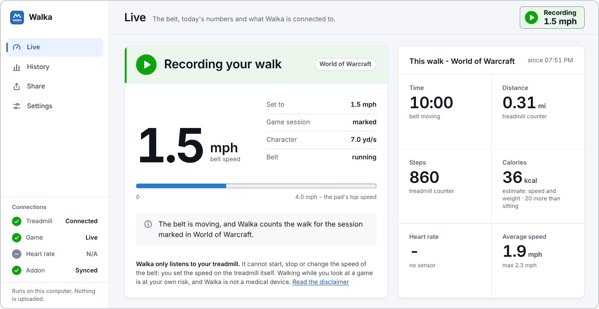
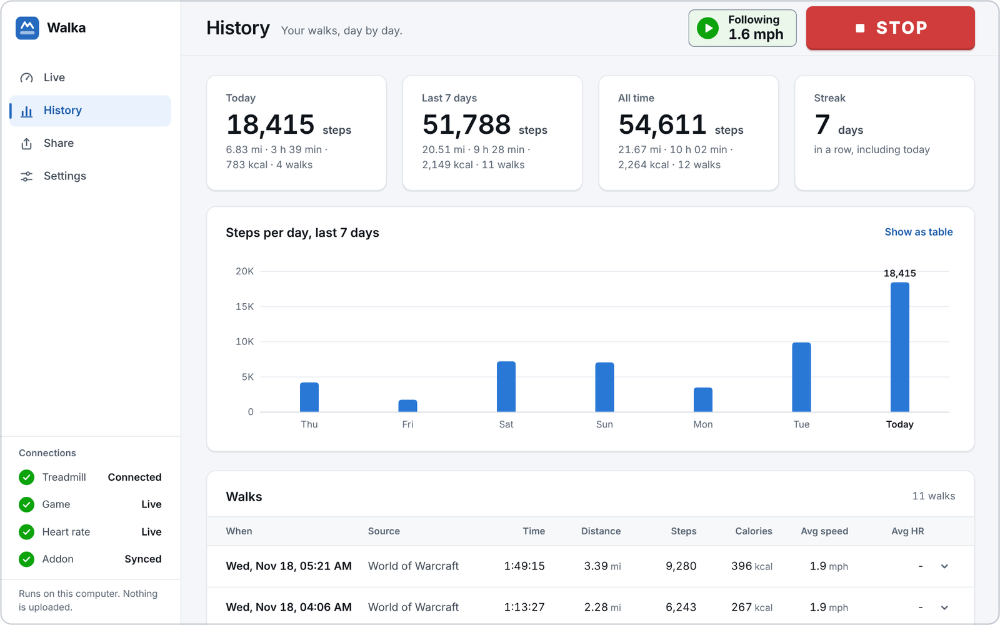
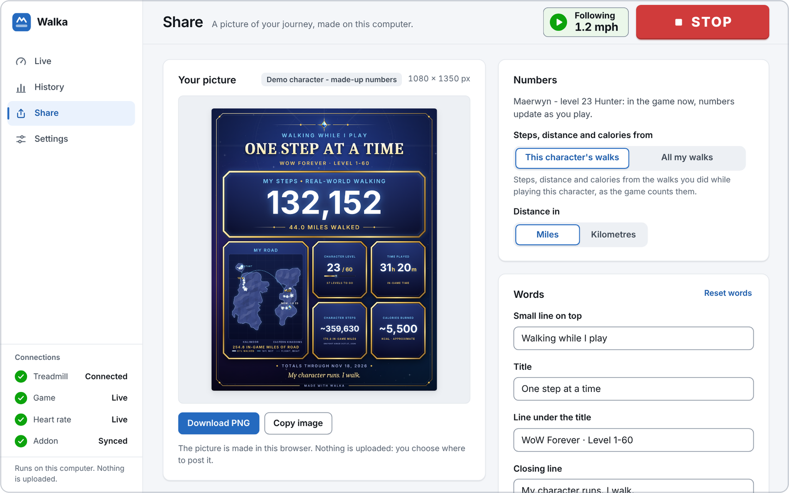
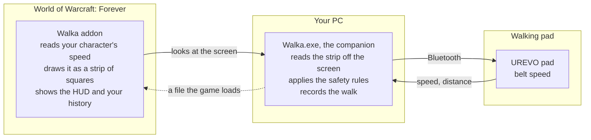

<h1 align="center">
   Walka
</h1>

<p align="center">
  <b>Walk on your walking pad while you play World of Warcraft.</b><br>
  The belt follows your character: faster when it runs, slower when it stands still.
</p>

<p align="center">
  <a href="https://github.com/AntonyPerez0/walka-addon/releases/latest/download/Walka.exe"></a>
</p>

<p align="center">
  One file, <code>Walka.exe</code> · Free · No setup - you just open it
</p>

<p align="center">
  <a href="#get-started">Get started</a> ·
  <a href="#what-you-get">What you get</a> ·
  <a href="#stopping-the-belt">Stopping the belt</a> ·
  <a href="#safety">Safety</a> ·
  <a href="#troubleshooting">Troubleshooting</a>
</p>

<p align="center">
  <a href="https://github.com/AntonyPerez0/walka-addon/actions/workflows/ci.yml"></a>
  
  
  
</p>

<p align="center">
  <picture>
    <source media="(prefers-color-scheme: dark)" srcset="docs/images/dashboard-dark.png">
    
  </picture>
</p>

This is the Windows program that goes with the **Walka addon** in the
game. You need both: the addon watches your character, and this program
talks to your walking pad.

**You need:** a Windows 10 or 11 PC with Bluetooth, a UREVO Strol 2E
walking pad (other Bluetooth walking pads may work), and World of
Warcraft: Forever.

## Get started

1. **Download `Walka.exe`** with the button above. It goes to your
   *Downloads* folder. If the browser says it "isn't commonly downloaded",
   choose **Keep** (in Edge: **...** → **Keep** → **Keep anyway**).
2. **Double-click it.** A black window opens: that is Walka. **Leave it
   open while you walk** - closing it stops Walka. The *dashboard* page
   opens in your browser (if not, go to `127.0.0.1:8787`).

   The first time, Windows may say *"Windows protected your PC"*. Click
   **More info**, then **Run anyway**. (Walka is not signed by a company,
   so Windows does not recognise it yet.)
3. **Follow "Getting started" on the dashboard.** It ticks each step off as
   you do it:
   * **Connect the treadmill:** switch the pad on and close the UREVO
     phone app. Don't pair it in Windows Bluetooth settings - Walka finds
     it by itself.
   * **Install the game addon:** if you got Walka from CurseForge it is
     already there. If not, click *Install* on the dashboard, then restart
     the game and tick *Walka* in the AddOns list.
   * **Let Walka see the game:** start World of Warcraft in *Windowed* or
     *Windowed (Fullscreen)* mode and keep the top-left corner of the game
     uncovered.
   * **Enter your weight and height:** for the calorie count.

> [!WARNING]
> **Early version - not yet tried on a real walking pad.** Read
> [Before your first walk](#before-your-first-walk) and keep the pad's
> remote in your hand the first time.

4. **Walk.** Step onto the pad and, in the game, click the ▶ button on the
   small Walka box (or type `/walka start`).

**To stop the belt at any time:** the pad's own remote, **Ctrl+Alt+X** on
the keyboard, or the red **STOP** on the dashboard.

## What you get

<table>
  <tr>
    <td width="33%" valign="top">
      <b>🏃 Follows your character</b><br>
      Run in the game and the belt speeds up. Stand still and it eases off. You choose every speed.
    </td>
    <td width="33%" valign="top">
      <b>🛑 Built around stopping</b><br>
      A hard speed cap, a STOP key that works from inside the game, and a belt that never speeds up when the signal is lost.
    </td>
    <td width="33%" valign="top">
      <b>📊 Counts every walk</b><br>
      Time, distance, steps and calories - live on the dashboard, and in the game while you play.
    </td>
  </tr>
  <tr>
    <td width="33%" valign="top">
      <b>🗺️ Your road on the map</b><br>
      The path your character has travelled, drawn on the game's world map - brightest where you really walked.
    </td>
    <td width="33%" valign="top">
      <b>🖼️ A picture to share</b><br>
      Your journey so far as a picture, made on your own computer. You choose what is on it and where it goes.
    </td>
    <td width="33%" valign="top">
      <b>🔒 Stays on your PC</b><br>
      Nothing is uploaded, and nothing is ever sent to the game: no key presses, no mouse input, no memory reading.
    </td>
  </tr>
</table>

<table>
  <tr>
    <td width="50%" align="center">
      <picture>
        <source media="(prefers-color-scheme: dark)" srcset="docs/images/history-dark.png">
        
      </picture>
      <br><sub><b>History</b> - every walk, with totals and a chart of your week</sub>
    </td>
    <td width="50%" align="center">
      <picture>
        <source media="(prefers-color-scheme: dark)" srcset="docs/images/share-dark.png">
        
      </picture>
      <br><sub><b>Share</b> - your journey as a picture</sub>
    </td>
  </tr>
</table>

---

## The details

Everything below is the long version, for when you want it.

**The basics** ·
[What Walka is](#what-walka-is) ·
[How it works](#how-it-works) ·
[What you need](#what-you-need) ·
[Install, step by step](#install-step-by-step) ·
[Using it](#using-it)

**Walking** ·
[Stopping the belt](#stopping-the-belt) ·
[Safety](#safety) ·
[Before your first walk](#before-your-first-walk) ·
[Heart rate](#heart-rate-optional) ·
[Other games, or no game](#other-games-or-no-game)

**Your numbers** ·
[Garmin Connect, Strava and others](#garmin-connect-strava-and-others) ·
[Your journey, and a picture to share](#your-journey-and-a-picture-to-share) ·
[The road map](#the-road-map)

**Help** ·
[Is this allowed?](#is-this-allowed) ·
[Troubleshooting](#troubleshooting) ·
[Ideas for later](#ideas-for-later) ·
[Development](#development)

## What Walka is

Walka links an under-desk walking pad to **World of Warcraft: Forever**:
the belt speeds up when your character runs, eases off when it stands, and
an in-game HUD counts your speed, steps, distance and calories - for this
session and every one before it.

It is two pieces:

* **the addon** (`Walka/`) - reads your character's movement, decides how
  fast the belt should go, and shows the HUD, history and settings in game;
* **the companion** (`companion/`, the `Walka.exe` you download above) - a
  small Windows app that reads the addon's signal off the screen, drives
  the treadmill over Bluetooth with a set of safety rules, records your
  walks, and shows a live dashboard in your browser.

Built for the **UREVO Strol 2E (URTM030)**; it should work with any
treadmill that speaks standard Bluetooth FTMS with speed control. The
companion also works without any game (manual sessions), and logs walks you
do with just the remote.

## How it works



An addon cannot use Bluetooth, files or the network, so it *draws* its state
as a thin strip of black and white squares in the top-left corner of the
game window, ten times a second. The companion takes a tiny screenshot of
that corner and decodes it. **Nothing is ever sent to the game** - no key
presses, no mouse input, no memory reading.

An addon also cannot receive live data, so the in-game HUD shows the
addon's own estimate of the belt (it knows the speed it asked for and how
the companion ramps), and the companion's *measured* numbers are written to
a file the game loads at login or on `/reload`. The dashboard always shows
the measured numbers live.

Details: [docs/PROTOCOL.md](docs/PROTOCOL.md).

## What you need

* Windows 11 (Windows 10 generally works) with Bluetooth 4.0 / "LE" or
  newer.
* The walking pad, switched on, **not** paired in Windows Bluetooth
  settings, and with the UREVO phone app **closed** (the pad accepts one
  connection at a time).
* WoW: Forever in *Windowed* or *Windowed (Fullscreen)* mode, with the
  top-left corner of the game visible.

## Install, step by step

1. **Get the companion.** Download
   [`Walka.exe`](https://github.com/AntonyPerez0/walka-addon/releases/latest/download/Walka.exe)
   (every version is on the
   [Releases page](https://github.com/AntonyPerez0/walka-addon/releases)),
   or run it from source (Python 3.10 or newer):

   ```
   cd companion
   py -m pip install -e .
   py -m walka
   ```

2. **Run it.** A console window opens and your browser shows the dashboard
   at <http://127.0.0.1:8787>.
3. **Install the addon.** With the game closed, on the dashboard:
   *Settings → Game addon → Install automatically*. (Or copy the `Walka`
   folder to `World of Warcraft\_forever_\Interface\AddOns\` yourself.)
   Start the game and tick *Walka* in the AddOns list.
4. **Connect the treadmill.** Switch it on: Walka looks for it by itself.
   To pick one yourself: dashboard → *Treadmill → Scan*, then *Connect*
   next to `URTM030`.
5. **Tell it about you.** *Settings → Body profile*: weight and height
   (used for calories and steps).

## Using it

In game, step onto the pad and press the ▶ button on the HUD (or type
`/walka start`). `/walka` shows or hides the HUD. The treadmill counts down
and the belt starts slowly; from then on it follows your character:

| Your character is…          | Belt (defaults)  |
|-----------------------------|------------------|
| standing still              | 0.8 mph          |
| walking                     | 1.2 mph          |
| running                     | 1.6 mph          |
| on a fast mount             | 2.0 mph          |
| on a flight path            | running pace     |
| anything faster/slower      | in between - Sprint really does speed you up |

A real run speed (14 mph!) is not something to match under a desk, so every
one of those numbers is yours to set in `/walka options`. The defaults sit
where people settle on treadmill desks (1-2 mph); raise them as you get
used to it. Also there:

* how quickly the belt reacts (*Steady*, *Balanced*, *Responsive*);
* a maximum (2.5 mph by default; the companion has its own hard cap,
  3.0 mph by default);
* **Keep walking when my character stands still** - the belt holds your
  walking pace through stops (looting, casting, reading a quest), so they
  cost no steps. Also on the HUD's right-click menu and as
  `/walka keepwalking`;
* or the opposite: stop the belt outright when you stand still.

**Pause** / **Stop** are on the HUD too. Going AFK pauses automatically;
the session resumes when your character next moves.

| Command | |
|---|---|
| `/walka` | show or hide the HUD |
| `/walka start` · `pause` · `resume` · `stop` | control the session |
| `/walka keepwalking on` \| `off` | hold the walking pace when your character stops |
| `/walka history` | past sessions, totals, 7-day chart |
| `/walka journey` | your character's journey so far (see [below](#your-journey-and-a-picture-to-share)) |
| `/walka options` | settings |
| `/walka status` | what the addon is doing right now |
| `/walka weight 180lb` · `/walka height 5'11` | your body, if you do not run the companion |
| `/walka units mph` \| `kmh` | display units |
| `/walka beacon on` \| `off` \| `size 2-8` | the signal strip |

### Numbers: estimated now, measured later

The HUD's live numbers are marked `~`: they are the addon's estimate. After
a walk, press **Sync** in the history window (it reloads the interface; a
session in progress carries on) or just log in next time, and the history
switches that session to what the treadmill measured. The dashboard shows
measured values the whole time - put it on a second monitor. (It is only
reachable from the PC itself: it can start and stop the belt, so it is not
offered to other devices on your network.)

### In combat

WoW: Forever hides your character's exact speed from addons during combat.
Walka does not work around that. While it is hidden the addon estimates:
moving or not, at your last known run speed. The HUD tooltip tells you when
this is happening.

### Calories and steps

* **Calories** come from belt speed and your weight, using an equation
  validated at slow desk-walking speeds (the usual treadmill formula reads
  11-35% low there). Expect roughly ±10% for an individual. The dashboard
  also shows how much of it is *on top of* what sitting would have burned.
* **Steps** are the treadmill's own count if it reports one; otherwise they
  are estimated from belt speed and your height. People differ by 6-20% at
  slow speeds, so there is a *step calibration* setting: count your steps
  for a minute, divide by what Walka counted.
* A **wrist watch will not count these steps** - with your hands on the
  keyboard your arm does not swing. Walka's count is the record.

## Stopping the belt

Fastest first:

1. the treadmill's **remote**, stop button or safety key - Walka then
   leaves the belt stopped;
2. **Ctrl+Alt+X** anywhere on the PC, even inside the game (Windows; change
   it under *Settings → Safety limits*);
3. the red **STOP** on the dashboard;
4. *Stop* on the HUD, or `/walka stop`.

## Heart rate (optional)

Any Bluetooth heart-rate sensor works: a chest strap, an arm band, or a
watch that can broadcast. Dashboard → *Settings → Heart-rate sensor → Scan*.

**Garmin Instinct 2 / Instinct 2 Solar:** hold *MENU* → *Sensors &
Accessories* → *Wrist Heart Rate* → *Broadcast Heart Rate*, then press
*GPS* to start broadcasting (press it again to stop). Watch-to-Windows
Bluetooth is known to be hit-and-miss and broadcasting uses battery; a
cheap Bluetooth chest strap or arm band is the dependable option.

Heart rate is shown live and stored with each walk. It only drives the
calorie figure when you have entered age and sex *and* your heart rate is
in real exercise territory (above 60% of the maximum for your age, for a
minute) - at desk-walking heart rates the heart-rate formula would read up
to double.

## Garmin Connect, Strava and others

Each walk can be downloaded as a **TCX** file (dashboard → *History* → a
walk → *TCX*) and imported by hand: on connect.garmin.com, *Activities* →
*Import*. Imported walks show time, distance, calories and heart rate.
Garmin does not add their steps to your daily step total.

## Your journey, and a picture to share

Walka keeps a record for every character you play: the level it has
reached, its time played and how far it has travelled on foot - and next to
that the real walking *you* did while playing it. `/walka journey` shows it
in game, and the dashboard's **Share** page turns it into a picture you can
post.

1. Log in with the companion running. The character's numbers reach the
   companion within about ten seconds (over the same strip as everything
   else) and are remembered there, so the picture can also be made later,
   with the game closed.
2. Dashboard → *Share*. Pick the character if you have several, change the
   words, tick what should be on the picture, and choose a theme (Sapphire,
   Ember, Wildwood, Frost or Parchment) and a size: portrait 1080×1350,
   square 1080×1080, story 1080×1920 or wide 1200×675.
3. **Download PNG** - or **Copy image** and paste it straight into a post or
   a chat.

What is on it:

| On the picture | What it is |
|---|---|
| **My steps** | Your real-world steps, and under them the distance you walked. With *This character's walks* these are the walks you did while playing that character, as the addon counts them; with *All my walks* they are everything the companion has recorded, with any game or none. |
| **My road** | The road your character has travelled, as a line: see [The road on the picture](#the-road-on-the-picture). |
| **Character level** | The level, and the level cap of the game. |
| **Time played** | The game's own `/played` for this character. |
| **Character steps** | How far the character has gone on foot since Walka began tracking it, as steps, with the in-game distance under it. |
| **Calories** | The same estimate as everywhere else in Walka (see [Calories and steps](#calories-and-steps)), rounded. |
| *Totals through ...* | The day the numbers were last received from the game. |

A `~` in front of a number means "about":

* **Character steps are a convention.** The game does not count steps, so
  Walka says a character takes 2,000 steps to the in-game mile of 1,760
  yards - 0.88 yards a step. "On foot" is moving while not mounted, not on
  a flight path, not flying and not swimming; running back as a ghost and
  jumping count. In combat, where the game hides the exact speed, the
  addon's estimate is used. Distance is counted from the day the addon was
  installed, not from level 1.
* **Calories** are always an estimate.
* **Your own steps** carry a `~` only while part of them is still the
  addon's estimate, until the game has loaded what the treadmill measured
  (*Sync*, or the next login).

### The road on the picture

The road the addon records (see [The road map](#the-road-map)) is drawn on
the picture over a small map of the continent - not the game's map, but a
low-poly drawing of Walka's own: the shape of the land in facets, in the
picture's colours.

* The stretches you walked **on the treadmill** are a bright line; what the
  character travelled while the belt stood still is the same line in a
  quieter colour; flight paths are fine dashes. A key under the map shows a
  piece of each kind of line with what it means - and how much of the road
  you walked for real.
* *START* marks where the road begins, a gem marked *NOW* with the
  character's level where it is, and a small numbered stud every tenth
  level reached on the way. The words are put where they cover neither a
  mark nor the road.
* Kalimdor and the Eastern Kingdoms are shown whole, side by side on one
  sea and to one scale, with a dashed arc where you crossed from one to
  the other (the boat, the zeppelin).
* A character that has only been on one continent and has not gone far yet
  gets a **close-up**: the stretch of coast it has walked, with a small map
  of the whole continent in a corner that frames where that is. The
  close-up widens as the road grows; once it would show most of the
  continent anyway, all of it is shown.
* A long road - wound tight around every village, as roads are by level
  20 - is drawn with a finer line, so that it stays a road and not a blot.
* Under the map: the length of the road in in-game miles (flights not
  counted). This is the road the addon *recorded* - mounted stretches
  included, dungeons not - so it differs from the miles on foot in the
  *Character steps* tile.

The coasts are generalised - straight edges, small inlets filled in - but
the towns, harbours and quest areas lie on the land (all but a few tiny
islets, which are left off the map), so a line across the water means you
really were at sea. A continent the companion has no map of (should the
game ever have one) still gets its road, on an empty chart.

The road is far too much for the strip on the screen, so it takes the slow
way: **the game saves it when you log out or type `/reload`**, and the
companion reads it from the game's own file
(`WTF\Account\...\SavedVariables\Walka.lua` in the game's folder). So the
road on the picture is as of your last logout or `/reload` - the Share page
says when that was - while the numbers next to it are live. Type `/reload`
before you make the picture and both are current.

The companion has to know where the game is for this; it does when the
addon is installed (*Settings → Game addon*). The file is only ever read, never
changed. Untick *My road* and the picture is as it was without it.

Private by default:

* The picture is drawn in your browser from numbers that are already on
  your PC. Nothing is uploaded and nothing is posted for you.
* The road is read from a file on your PC and goes no further than the
  page that draws it. On the picture it is a line on a simplified map and
  the names of the continents - no zones, no place names, no coordinates.
* Your character's name, and the small line with your weight and average
  pace, are **off** until you tick them. The realm never leaves the game:
  the companion is only sent a number that tells your characters apart.
* The downloaded file is named after the date, never after the character.
* The design is Walka's own and is drawn by the page itself: no game
  artwork, logos or fonts are used. The continents on the map are Walka's
  own drawing too (see [THIRD-PARTY-NOTICES.md](THIRD-PARTY-NOTICES.md) for
  how their outlines were made).

`py -m walka --demo` has a made-up character to try the page with; it is
never saved.

## The road map

From the moment the addon is installed it keeps the road your character
travels - install it before you start a character and the road begins at
level 1. It is drawn **on the game's own world map**: open the map as you
always do (or type `/walka map`, or pick *Road map* in the HUD's
right-click menu) and the road is on it, on every map of the world - all
of Azeroth, a continent, or a zone in the game's full detail.

* the road is coloured by level, a colour for every ten levels;
* the stretches you walked **on the treadmill** are bright, with a soft
  glow; what your character travelled while the belt stood still is dimmer;
* flight paths are thin and pale;
* the road runs right up to your character and grows as you walk, with the
  map open;
* it lies over the map's picture and under what the map marks (quest icons,
  your arrow), and it takes no clicks: the map works as it did.

**With [OpenMap](https://github.com/openmap-world/openmap)** installed the
road is drawn on OpenMap's seamless map in the same way - Walka asks
OpenMap where a place is on its map, through the interface OpenMap offers
other addons - and *My road (Walka)* is a switch in OpenMap's menu (under
*On the map*) that can be starred onto the map like OpenMap's own. Nothing
has to be set up; without OpenMap the road is on Blizzard's map.

A small *Walka road* button in the top-left corner of the map hides and
shows the road, and its tooltip says what the colours mean. `/walka map
off` and `/walka map on` do the same, and the options page (*Your road*)
has both the road and the button as tick boxes.

Walka does not open the world map for you in combat: the game restricts
what an addon may do to the map during a fight. `/walka map` then says so
and opens Walka's own road window instead; open the world map yourself and
the road is on it. (With OpenMap's view for controllers, which lays its own
picture over the map's, the road cannot be seen; the button's tooltip says
so.)

Walka's own road window is still there as `/walka map window`: one
continent at a time, the mouse wheel zooms, dragging moves the map, *Me*
centres it on your character, *Fit* shows the whole continent, `<` and `>`
change continent, and *Screenshot* saves a picture of the screen. It is
also what `/walka map` opens in combat, and should the game's world map not
be found.

What is recorded: a point every twenty yards (fewer on flight paths, more
where the road bends), nothing while you stand still, nothing inside
dungeons, raids and battlegrounds (the game does not say where you are
there). It is saved per character with your other addon settings and never
leaves your PC (the companion reads it there, to draw it on the
[Share picture](#the-road-on-the-picture)). `/walka road off` stops the
recording (`on` starts it again); what is recorded so far is kept. A road
from level 1 to 60 comes to about a megabyte.

If the road does not show, `/walka mapcheck` prints what the game answered
when Walka asked for its maps, whether it found the world map and OpenMap,
and what it drew.

The way the road is recorded and drawn follows
[Road to Sixty](https://github.com/Jordanburch101/road-to-sixty) by Jordan
Burch (MIT licence, see [THIRD-PARTY-NOTICES.md](THIRD-PARTY-NOTICES.md)) -
an addon made for exactly this, with a replay of the whole journey, a
journal of quests and kills, and much more. It runs fine next to Walka.
Nothing of OpenMap is in Walka: it only calls OpenMap when OpenMap is
there.

## Other games, or no game

The dashboard has a **manual session**: start, pause, stop and speed
buttons. Use it with any game, or for a plain walk. And if you just walk
with the treadmill's remote while the companion is running, that walk is
recorded too.

## Safety

Short version - the long one is [docs/SAFETY.md](docs/SAFETY.md):

* Nothing moves until you press Start.
* A hard speed cap (3.0 mph until you raise it, never above 4.0 mph) that
  no game state can exceed, and gentle, rate-limited speed changes.
* If the companion loses sight of the game it holds, then slows, then
  pauses the belt. It never speeds up on a lost signal.
* Stop the belt at the treadmill and Walka leaves it stopped.
* After any pause it did not watch you start, the belt waits for your
  character to move.

Bluetooth is not an emergency stop: keep the remote within reach.

## Is this allowed?

Honestly: **it is not approved by Blizzard, and you use it at your own
risk.**

What Walka does and does not do:

* The addon uses only the public addon API, is free and unobfuscated, and
  follows the addon policy.
* The companion never sends input to the game, never automates anything
  in the game, never reads the game's memory or files (other than its own
  addon folder). It looks at one corner of your screen, the way a
  screenshot tool does, and what it reads is your own character's movement
  state.
* When the game hides a value from addons (speed in combat), Walka does not
  relay it; it estimates instead.

Blizzard's enforcement statements target automation, input broadcasting,
client modification and tools that get around addon restrictions for an
advantage; Walka is none of those. But Blizzard's EULA is written broadly
(it prohibits unauthorised software that "reads" information from the
game), Blizzard does not pre-approve third-party tools, and no statement
says a passive screen reader like this is fine. Similar addon-plus-reader
projects exist publicly for this client; that is not the same as
permission.

## Before your first walk

The pad and the game have not been tested against this code. Do these, in
order:

1. **`Walka.exe probe`** (or `py -m walka probe`). Read-only: it lists what
   the pad exposes and listens while you operate it with the remote. It
   cannot move the belt. Keep the report - it settles the open questions in
   [docs/HARDWARE.md](docs/HARDWARE.md).
2. **A manual session from the dashboard while standing next to the pad**,
   not on it. Start, change speed, pause, stop, press STOP, press
   Ctrl+Alt+X. Stop it with the remote and check Walka leaves it stopped.
3. **`Walka.exe beacon`** with the game running: checks that the strip can
   be read from your screen.
4. **In game**, the checks in
   [docs/IN-GAME-CHECKLIST.md](docs/IN-GAME-CHECKLIST.md).
5. Then walk - slowly at first.

## Troubleshooting

| Symptom | Try |
|---|---|
| Treadmill not found | Is it on? Close the UREVO phone app (force-quit it). Remove the pad from Windows *Bluetooth & devices* if you paired it there. A USB Bluetooth 5 adapter helps with weak built-in radios. |
| Dashboard says *no game signal* | Run the game windowed or borderless; keep the top-left corner uncovered; `/walka beacon on`; try `/walka beacon size 6`; run `Walka.exe beacon`. |
| Belt does not follow | Is a session started (`/walka status`)? Does the dashboard say *waiting for you to move your character* or *stopped at the treadmill*? Press Resume. |
| "Waiting for the treadmill to finish its previous workout" | Normal for about ten seconds after a stop: the pad ignores a start until then. |
| Speed is one step off | Set *Settings → Treadmill → Firmware speed grid* to mph (or km/h) instead of auto. |
| History shows `~` numbers | Press *Sync* in the history window after the companion has saved the walk; check *Settings → Game addon* shows the right folder. |
| Addon marked out of date after a game patch | Tick *Load out of date AddOns*, and update the `## Interface:` line in `Walka/Walka.toc`. |
| The pad keeps waking up | The companion only reconnects when a session starts or you press Connect; closing the companion releases the pad entirely. |

## Ideas for later

* A foot pod or other Bluetooth cadence sensor for true step counts.
* Goals and streak rewards in game; milestones announced in chat.
* Per-game plugins for other games (the companion's manual mode already
  works with anything).
* Reading daily totals back from Garmin's personal API.

## Development

```
py -m pip install -e "companion[dev]"
py -m pytest          # companion tests + addon tests (the addon runs under a mocked game client)
```

* `Walka/` - the addon. `Core/` is pure Lua (no game API) and is unit
  tested; `Game.lua` is the only file that touches values the game may hide.
* `companion/src/walka/` - `governor.py` (the safety rules), `treadmill/`
  (Bluetooth FTMS driver and a simulator), `capture.py` + `beacon.py`
  (reading the strip), `session.py`, `addon_sync.py`, `web.py` + `static/`
  (dashboard), `app.py` (wiring), `cli.py`; `journey.py` (each character's
  journey, put together from the strip), `savedvars.py` + `road.py` (the
  road, read from the game's saved file) and `static/share.js`, `card.js`,
  `cardmodel.js` (the Share page and the picture it draws), `lands.js` (the
  low-poly continents behind the road; made by `tools/gen_lands.py`).
* `tests/addon/` - loads the real addon files into a mock of the game's
  API that is checked against Blizzard's published API documentation for
  this client build (`tools/gen_api_snapshot.py` regenerates the snapshot).
* `py -m walka --demo` runs everything against a simulated treadmill and a
  scripted character.
* **Publishing a version:** put the same number in
  `companion/pyproject.toml`, `companion/src/walka/__init__.py` and
  `Walka/Walka.toc`, commit and push. Then, on GitHub, open **Actions** →
  **CI** → **Run workflow**, type the number (`0.1.0`) and run it. (Pushing
  a tag does the same: `git tag v0.1.0`, `git push origin v0.1.0`.) When
  the run finishes, the **Releases** page has `Walka.exe` (the download
  button at the top of this page always gives the latest one) and
  `Walka-addon.zip`, which you upload to CurseForge yourself. If the run
  fails nothing is published: fix it and run it again.

More: [docs/PROTOCOL.md](docs/PROTOCOL.md) ·
[docs/SAFETY.md](docs/SAFETY.md) · [docs/HARDWARE.md](docs/HARDWARE.md)

---

<p align="center">
  <sub>Walka is a fan-made tool. It is not affiliated with or endorsed by Blizzard Entertainment or UREVO.</sub>
</p>
