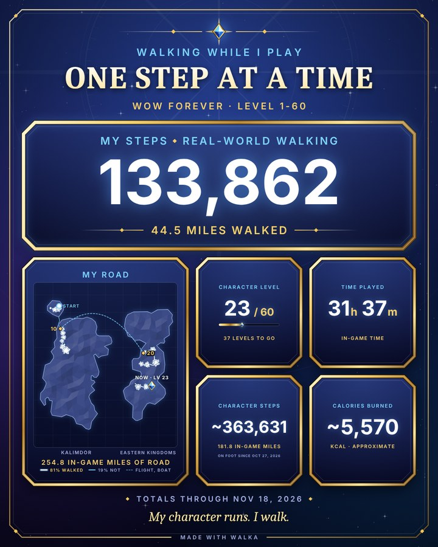
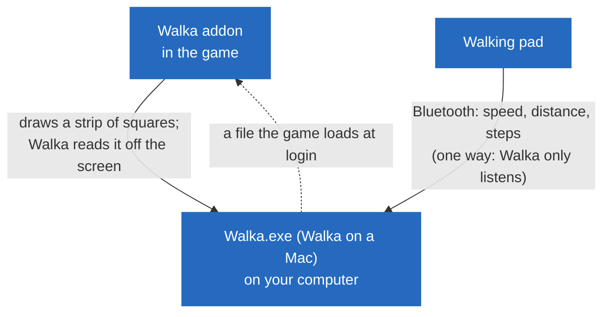

<h1 align="center">
   Walka
</h1>

<p align="center">
  <b>Walk on your walking pad while you play World of Warcraft.</b><br>
  Walka counts your steps, miles and calories, and draws your character's road on the map.
</p>

<p align="center">
  <a href="https://github.com/AntonyPerez0/walka-addon/releases/latest/download/Walka.exe"></a>
</p>

<p align="center">
  <a href="https://github.com/AntonyPerez0/walka-addon/releases/latest/download/Walka-mac-apple-silicon.zip"></a>
</p>

<p align="center">
  <a href="https://github.com/AntonyPerez0/walka-addon/releases/latest/download/Walka-addon.zip"></a>
</p>

<p align="center">
  <sub><b>Walka only listens to your treadmill.</b> It cannot start, stop or change the speed of the belt: you do that at the treadmill itself.<br>
  <b>Experimental:</b> not yet tried on a real walking pad. Walking while you play is at your own risk - read the <a href="DISCLAIMER.md">disclaimer</a> before you download.<br>
  <b>Free.</b> Nothing to install: on Windows it is one file, <code>Walka.exe</code>, and you just open it - it has a window of its own, like any program.<br>
  <b>Mac:</b> the button is for an Apple chip (M1 or later) - for an older Mac with an Intel processor, <a href="https://github.com/AntonyPerez0/walka-addon/releases/latest/download/Walka-mac-intel.zip">download this one</a>.
  The Mac version is new and has not been tried with the game on a real Mac yet: see <a href="#on-a-mac">On a Mac</a>.<br>
  <b>Game addon:</b> the Walka addon for World of Warcraft. Walka can also put it in the game for you (step 3).</sub>
</p>

<p align="center">
  <a href="#is-the-download-safe"></a><br>
  <a href="https://github.com/AntonyPerez0/walka-addon/releases/latest"></a>
</p>

<p align="center">
  <a href="#get-started">Get started</a> ·
  <a href="#what-you-get">What you get</a> ·
  <a href="#walka-only-listens">Walka only listens</a> ·
  <a href="#safety">Safety</a> ·
  <a href="#troubleshooting">Troubleshooting</a>
</p>

<p align="center">
  <picture>
    <source media="(prefers-color-scheme: dark)" srcset="docs/images/dashboard-dark.png">
    
  </picture>
</p>

This is the program - for Windows and for Mac - that goes with the
**Walka addon** in the game. You need both: the addon knows which character
you are playing, and this program listens to your walking pad.

**You need:** a Windows 10 or 11 PC or a Mac (Apple silicon or Intel), with
Bluetooth, a walking pad or treadmill that shows its numbers to apps over
Bluetooth (a UREVO Strol 2E, a WELLFIT TM029 Pro, or another Bluetooth FTMS
treadmill - see [which treadmills work](#which-treadmills-work)), and
World of Warcraft: Forever.

## Get started

> [!NOTE]
> **Walka only listens to your treadmill.** It reads the speed, distance
> and steps the treadmill reports, and writes your walks down. It cannot
> start or stop the belt or change its speed - nothing in it can. You set
> the speed at the treadmill, with its own remote and buttons.
> (Versions up to 0.6 did drive the belt. They have been withdrawn.)

> [!WARNING]
> **Early version - not yet tried on a real walking pad.** Read
> [Before your first walk](#before-your-first-walk).

> [!CAUTION]
> **Walking while you play is at your own risk.** Your eyes are on a game,
> not on your feet. Walka comes with no warranty, and it is not a safety
> device or a medical device. If you have a health condition, are pregnant
> or are in any doubt, ask a doctor first - and stop if you feel dizzy or
> unwell. The whole of it: [DISCLAIMER.md](DISCLAIMER.md).

*These steps are for Windows. On a Mac, steps 1 and 2 are different - they
are under [On a Mac](#on-a-mac) - and the rest is the same.*

1. **Download `Walka.exe`** with the button above. It goes to your
   *Downloads* folder. If the browser says it "isn't commonly downloaded",
   choose **Keep** (in Edge: **...** → **Keep** → **Show more** → **Keep
   anyway**).
2. **Double-click it.** Walka opens in a window of its own, with its
   *dashboard* in it. **Leave it open while you walk** (minimised is
   fine) - closing the window closes Walka: the walk is saved and the
   recording ends (the belt is not touched).

   The first time, Windows may say *"Windows protected your PC"*. Click
   **More info**, then **Run anyway**. (Walka is not signed by a company,
   so Windows does not recognise it yet. It does not mean that anything
   was found: see [Is the download safe?](#is-the-download-safe))
3. **Follow "Getting started" on the dashboard.** It ticks each step off as
   you do it:
   * **Connect the treadmill:** switch it on and close its own phone app
     (UREVO, WELLFIT Fitness, ...). Don't pair it in Windows Bluetooth
     settings - Walka finds it by itself.
   * **Install the game addon:** click *Install* on the dashboard, then
     restart the game and tick *Walka* in the AddOns list. (By hand
     instead: unzip the [addon download](https://github.com/AntonyPerez0/walka-addon/releases/latest/download/Walka-addon.zip)
     into `World of Warcraft\_forever_\Interface\AddOns`.)
   * **Let Walka see the game:** start World of Warcraft in *Windowed* or
     *Windowed (Fullscreen)* mode and keep the top-left corner of the game
     uncovered.
   * **Enter your weight and height:** for the calorie count.
4. **Walk.** In the game, click the ▶ button on the small Walka box (or
   type `/walka start`): that says "this walk is for this character".
   Then step onto the pad and start the belt **with the treadmill's own
   remote**, at the speed you like.

**The belt is yours.** Start it, stop it and change its speed at the
treadmill - its remote, its buttons, its safety key. Walka has no button
for any of that.

## What you get

- 👂 **Only listens.** Walka reads what your treadmill reports. It sends
  it no commands: the belt does what you tell it at the treadmill, and
  nothing else.
- 📊 **Counts every walk.** Time, distance, steps and calories - live on
  the dashboard, and in the game while you play. A walk is recorded
  whenever the belt moves, with a game or without.
- 🧙 **Your walks, per character.** Start a session in the game and the
  walk counts for the character you are playing.
- 🗺️ **Your road on the map.** The path your character has travelled,
  drawn on the game's world map - brightest where you really walked.
- 🖼️ **A picture to share.** Your journey so far as a picture, made on
  your own computer. You choose what is on it and where it goes.
- 🔒 **Stays on your computer.** Nothing is uploaded. Walka never presses keys,
  moves the mouse or reads the game's memory - it looks at the top-left
  corner of the game window ([what it looks at, exactly](#what-walka-looks-at)).

<p align="center">
  
  <br><sub>A <b>Share</b> picture, made with the demo character</sub>
</p>

## The details

Everything below is the long version, for when you want it.

**The basics** ·
[What Walka is](#what-walka-is) ·
[How it works](#how-it-works) ·
[What you need](#what-you-need) ·
[Which treadmills work](#which-treadmills-work) ·
[Install, step by step](#install-step-by-step) ·
[On a Mac](#on-a-mac) ·
[Using it](#using-it)

**Walking** ·
[Walka only listens](#walka-only-listens) ·
[Heart rate](#heart-rate-optional) ·
[Garmin Connect, Strava and others](#garmin-connect-strava-and-others) ·
[Your journey, and a picture to share](#your-journey-and-a-picture-to-share) ·
[The road map](#the-road-map) ·
[Other games, or no game](#other-games-or-no-game)

**Safety and help** ·
[Safety](#safety) ·
[Disclaimer](DISCLAIMER.md) ·
[Report a security problem](SECURITY.md) ·
[Is the download safe?](#is-the-download-safe) ·
[Is this allowed?](#is-this-allowed) ·
[Before your first walk](#before-your-first-walk) ·
[Troubleshooting](#troubleshooting) ·
[Ideas for later](#ideas-for-later) ·
[Development](#development)

## What Walka is

Walka is a walking log for people who walk on an under-desk pad while they
play **World of Warcraft: Forever**. You walk at the speed you set on the
pad; Walka counts your time, steps, distance and calories - for this walk
and every one before it - shows them in an in-game HUD, and keeps them per
character.

It is two pieces:

* **the addon** (`Walka/`) - marks your walking sessions, knows which
  character they belong to, and shows the HUD, history, journey and road
  map in game;
* **the companion** (`companion/`, the `Walka.exe` you download above, or
  `Walka` on a Mac) - a small app that reads the addon's signal off the
  screen, listens to the treadmill over Bluetooth, records your walks, and
  shows a live dashboard in a window of its own.

Neither of them moves the belt. Until version 0.6 the companion did: the
belt followed your character. That was taken out - a motorised belt under
someone who is looking at a game was not worth the risk of a program
getting it wrong - and those versions have been withdrawn. See
[Walka only listens](#walka-only-listens).

Built around the **UREVO Strol 2E (URTM030)**, and made to read any
treadmill that reports its data over standard Bluetooth FTMS - see
[which treadmills work](#which-treadmills-work). The companion also works
without any game: a walk is recorded whenever the belt moves.

## How it works



An addon cannot use Bluetooth, files or the network, so it *draws* its state
as a thin strip of black and white squares in the top-left corner of the
game window, ten times a second. The companion takes a tiny screenshot of
that corner and decodes it. **Walka never sends input to the game** - no
key presses, no mouse input, no memory reading.

### What Walka looks at

* **The top-left corner of the game window** - a picture about 700 pixels
  wide and 12 high, some fifteen times a second. On Windows and on a Mac
  Walka asks the system where the game window is, and once it has found
  the game it looks nowhere else.
* **From when Walka is started until it first finds the game window** -
  that is, while the game is not running yet - it also looks at the
  top-left corner of each monitor and, every five seconds, takes one
  picture of the whole screen to search it for the strip. (So does a
  system that cannot say where a window is, all the time.) `Walka.exe
  beacon`, the command that checks whether the strip can be read, does the
  same once.
* **What happens to a picture:** it is searched for the strip, in the
  computer's memory, and then dropped. No picture is saved or sent
  anywhere, and of what is on it nothing is kept but the strip's ten bytes.
* **What the strip says:** whether a walking session is running or paused,
  how fast the character is going and how (on foot, mounted, swimming,
  flying, on a flight path), whether you are AFK, and the numbers of the
  [journey](#your-journey-and-a-picture-to-share). Not whether your
  character is fighting, dead or resting - the companion does not need to
  know, so the addon does not say.

An addon also cannot receive live data, so the in-game HUD shows the
addon's own estimate (counted from the pace you tell it: see
[Using it](#using-it)), and the companion's *measured* numbers are written
to a file the game loads at login or on `/reload`. The dashboard always
shows the measured numbers live.

Details: [docs/PROTOCOL.md](docs/PROTOCOL.md).

## What you need

* Windows 11 (Windows 10 generally works) with Bluetooth 4.0 / "LE" or
  newer - or a Mac, with an Apple chip or an Intel processor and a recent
  macOS (see [On a Mac](#on-a-mac)).
* The walking pad or treadmill, switched on, **not** paired in the
  computer's Bluetooth settings, and with its own phone app **closed**
  (most accept one connection at a time).
* WoW: Forever in *Windowed* or *Windowed (Fullscreen)* mode, with the
  top-left corner of the game visible.

## Which treadmills work

Walka reads **Bluetooth FTMS**, the standard that fitness apps use to show
a treadmill's speed and distance. If an app other than the maker's own can
*show the speed* of your treadmill, Walka very likely can too. The
treadmill does not have to be one that apps can control: Walka controls
nothing.

| Treadmill | How Walka finds it | What is known |
|---|---|---|
| **UREVO Strol 2E** and other UREVO pads | By name (`URTM...`), at once | Other open-source projects read it the same way. |
| **WELLFIT TM029 Pro** and other WELLFIT treadmills | By name (`WELLFIT TM Linker`), at once | Another open-source project works with a WELLFIT over FTMS. |
| **Any other FTMS treadmill** | By what it advertises, after a 15-second scan - or pick it yourself: dashboard → *Treadmill → Scan* | Depends on the treadmill. Check its numbers as in [Before your first walk](#before-your-first-walk). |

None of these has been tried by Walka's author on the real machine yet -
the warning at the top of this page is for all of them. Details and
sources: [docs/HARDWARE.md](docs/HARDWARE.md).

Things to know:

* **The speed is yours.** Walka sets none and limits none. How fast you
  walk is between you and the treadmill.
* **One connection at a time.** Most treadmills talk to one app. While
  Walka is connected, the maker's phone app cannot be - and the other way
  round.
* **Walka remembers your treadmill.** After the first connection it only
  reconnects to that one, so that a neighbour's walk is never counted as
  yours. *Forget this treadmill* on the dashboard lets you move to another.

**What will not work:** treadmills that only talk to their maker's app in
a private language (many NordicTrack / iFIT machines, the older KingSmith
WalkingPads), and bikes or rowers - Walka only reads treadmills.

**Is yours not listed, or not behaving?** Run `Walka.exe probe` (on a Mac:
[`Walka probe`](#on-a-mac)) with the treadmill on. Like Walka itself it only listens - it sends the treadmill no commands - and saves a
small text report.
[Open an issue](https://github.com/AntonyPerez0/walka-addon/issues) with
that report and the treadmill's make and model, and it can be added.

The saved report is made to be posted in public. It lists fitness machines
only - not the headphones, watches and televisions that are also in
Bluetooth range, yours or a neighbour's - with their addresses cut short,
and without the treadmill's serial number. (The window the probe runs in
shows everything: that is for your eyes. Post the file, not a screenshot
of the window.)

## Install, step by step

1. **Get the companion.** Download
   [`Walka.exe`](https://github.com/AntonyPerez0/walka-addon/releases/latest/download/Walka.exe)
   (every version is on the
   [Releases page](https://github.com/AntonyPerez0/walka-addon/releases)),
   or run it from source (Python 3.10 or newer):

   ```powershell
   cd companion
   py -m pip install -e .
   py -m walka
   ```

   On a Mac: [the zip for your Mac](#on-a-mac), or from source with
   `python3` in place of `py`.

2. **Run it.** Walka's window opens, with the dashboard in it. (The
   dashboard is a page served on your own computer, at
   <http://127.0.0.1:8787>: `--browser` shows it in your web browser
   instead, and `--no-window` shows it nowhere. See
   [Walka's window](#walkas-window).)
3. **Install the addon.** With the game closed, on the dashboard:
   *Settings → Game addon → Install automatically*. Or by hand: download
   [`Walka-addon.zip`](https://github.com/AntonyPerez0/walka-addon/releases/latest/download/Walka-addon.zip)
   and unzip it into `World of Warcraft\_forever_\Interface\AddOns\` (on a
   Mac: `/Applications/World of Warcraft/_forever_/Interface/AddOns/`), so
   that there is a `Walka` folder in it. Start the game and tick *Walka* in
   the AddOns list.
4. **Connect the treadmill.** Switch it on: Walka looks for it by itself.
   To pick one yourself: dashboard → *Treadmill → Scan*, then *Connect*
   next to yours (a UREVO Strol 2E shows as `URTM030`, a WELLFIT as
   `WELLFIT TM Linker`).
5. **Tell it about you.** *Settings → Body profile*: weight and height
   (used for calories and steps).

## On a Mac

> [!WARNING]
> **The Mac version is new.** GitHub's Macs build it, run its tests and
> check that the finished program starts, records a walk on a simulated
> pad and saves it when it is closed. Nobody has yet tried it with the game
> and a walking pad on a real Mac. Do everything under
> [Before your first walk](#before-your-first-walk) - and if you do,
> [say how it went](https://github.com/AntonyPerez0/walka-addon/issues).

1. **Download the zip for your Mac.** *Apple menu → About This Mac* says
   which: *Chip: Apple M...* →
   [`Walka-mac-apple-silicon.zip`](https://github.com/AntonyPerez0/walka-addon/releases/latest/download/Walka-mac-apple-silicon.zip);
   *Processor: ... Intel ...* →
   [`Walka-mac-intel.zip`](https://github.com/AntonyPerez0/walka-addon/releases/latest/download/Walka-mac-intel.zip).
2. **Open the zip** (double-click it in *Downloads*). Inside is the
   application, `Walka`. It runs from where it is; you can also drag it
   into *Applications*.
3. **Double-click `Walka`.** The first time, macOS refuses: *"Apple could
   not verify Walka is free of malware"*. Click **Done**, open **System
   Settings → Privacy & Security**, scroll down to *Security* and click
   **Open Anyway** next to Walka. (On macOS 14 and older: hold Control,
   click `Walka`, choose **Open**, then **Open**.) Walka is not signed with
   an Apple developer account, so macOS does not recognise it. It does not
   mean that anything was found: see
   [Is the download safe?](#is-the-download-safe)
4. **Walka's window opens**, with the dashboard in it. Leave it open while
   you walk (minimised is fine). Closing the window - or *Walka → Quit* -
   closes Walka: the walk is saved and the recording ends (the belt is not
   touched). From there it is step 3 of [Get started](#get-started).

macOS asks before a program may use Bluetooth or look at the screen, and it
asks about **Walka** by name:

* **Bluetooth** - to listen to the walking pad. Click **Allow**.
* **Screen Recording** - to see the strip the addon draws. The dashboard
  says when this is what is missing. Open **System Settings → Privacy &
  Security → Screen & System Audio Recording**, switch on **Walka**, then
  close Walka and open it again. Recent versions of macOS ask again every
  few weeks whether Walka may still do this: choose **Allow**.

After you replace Walka with a newer version, macOS may ask both again:
Walka is not signed with an Apple developer account, and to macOS a
program like that which has changed is a new program. (If the switch for
Walka is on but the dashboard still says the screen may not be recorded,
switch it off and on again.)

Both can be changed later in the same place in System Settings. Walka reads
the top-left corner of the game window - and, until it has found the game
for the first time, searches the screen for it: see
[What Walka looks at](#what-walka-looks-at). Nothing leaves your computer.

What is different from Windows:

* **The game** is looked for in `/Applications/World of Warcraft`. If
  yours is somewhere else, choose the addon folder yourself under
  *Settings → Game addon*.
* **Your settings and walks** are in
  `~/Library/Application Support/Walka`.
* **Commands** like `probe` and `beacon` are typed in Terminal: drag the
  `Walka` application into a Terminal window (that types where it is),
  then - with no space in between - type `/Contents/MacOS/Walka probe` and
  press Return. Started this way Walka belongs to Terminal as far as macOS
  is concerned: it is **Terminal** that is asked about, and allowed,
  Bluetooth and the screen.
* **From source:** `cd companion`, `python3 -m pip install -e .`,
  `python3 -m walka` (Python 3.10 or newer).

## Walka's window

Walka is a program with a window of its own: no console window to leave
open next to it, and no tab in your web browser. Closing the window closes
Walka - the walk being recorded is saved first, and the belt is not
touched.

* **What draws it.** The window shows the dashboard with what your
  system already has for showing pages inside programs: *Microsoft Edge
  WebView2* on Windows (part of Windows 11, and on nearly every
  Windows 10), WebKit on a Mac. Nothing is downloaded for it. The
  dashboard is still a page that Walka serves on your own computer, at
  `127.0.0.1:8787`, and still only there.
* **Without WebView2** (some Windows 10 PCs) Walka opens the dashboard in
  your web browser instead, and shows a small box that says *Walka is
  running*: leave it open while you walk, and press **OK** in it to close
  Walka.
* **In the browser on purpose:** start Walka with `--browser`, or set
  `"window": false` under `"web"` in `config.json`. `--no-window` shows
  the dashboard nowhere; it is still at its address.
* **Saving files.** *Download TCX* and *Download PNG* ask where to save
  the file. (In a browser they went to the downloads folder.)
* **Your settings and walks** are in `%APPDATA%\Walka` on Windows and in
  `~/Library/Application Support/Walka` on a Mac. Next to them is
  `walka.log`: what Walka used to write in its console window - what it
  connected to, what went wrong. It can hold your treadmill's name and
  Bluetooth address, and it stays on your computer unless you send it to
  somebody.
* **Typing a command** (`Walka.exe probe`, `Walka.exe beacon`) on Windows:
  open the folder `Walka.exe` is in, click the address bar at the top of
  that window, type `cmd` and press Enter. A command prompt opens in that
  folder: type the command there. The prompt comes back at once, before
  the command is done - what the command prints follows below it.

## Using it

In game, press the ▶ button on the HUD (or type `/walka start`): a walking
session starts for the character you are playing. Step onto the pad and
start the belt with the treadmill's remote, at whatever speed you like.
`/walka` shows or hides the HUD.

The companion records the walk from what the treadmill reports. A walk is
whatever the belt does:

* it is counted while the belt moves, and not while it stands still;
* with a session running in the game it is filed under that session, and
  so under your character;
* with no session - another game, no game at all - it is recorded all the
  same, as a walk of its own (*No game session* in the dashboard's
  history).

**Tell the addon your pace.** An addon cannot be told what the treadmill is
doing while the game runs, so the HUD counts with the speed you say the
belt is set to: `/walka pace 1.5`, the − and + buttons on the HUD, or
*Your pace* in `/walka options`. It starts at 1.5 mph - people settle at
1-2 mph on a treadmill desk. It only feeds the HUD's estimate; it changes
nothing at the treadmill, and the measured numbers replace the estimate
later (below).

**Pause** / **Stop** are on the HUD too. They pause and end the *session* -
the addon's count - and nothing else: stop the belt yourself, at the
treadmill, when you step off. Going AFK pauses the session automatically
(you can turn that off); it carries on when your character next moves.

| Command | What it does |
|---|---|
| `/walka` | show or hide the HUD |
| `/walka start` · `pause` · `resume` · `stop` | mark the walking session |
| `/walka pace 1.5` | the speed your treadmill is set to, for the HUD's estimate |
| `/walka history` | past sessions, totals, 7-day chart |
| `/walka journey` | your character's journey so far (see [below](#your-journey-and-a-picture-to-share)) |
| `/walka options` | settings |
| `/walka status` | what the addon is doing right now |
| `/walka weight 180lb` · `/walka height 5'11` | your body, if you do not run the companion |
| `/walka units mph` \| `kmh` | display units |
| `/walka beacon on` \| `off` \| `size 2-8` | the signal strip |

### Numbers: estimated now, measured later

The HUD's live numbers are marked `~`: they are the addon's estimate. After
a walk, press **Sync** in the history window (it reloads the interface; a
session in progress carries on) or just log in next time, and the history
switches that session to what the treadmill measured. The dashboard shows
measured values the whole time - put it on a second monitor. (It is only
reachable from the PC itself: it shows your walks, weight and height and
has no password, so it is not offered to other devices on your network.)

### In combat

WoW: Forever hides your character's exact speed from addons during combat.
Walka does not work around that. While it is hidden the addon estimates:
moving or not, at your last known run speed. That only matters for the road
and the journey's "character steps" - your own walk is counted from the
treadmill, not from the character.

### Calories and steps

* **Calories** come from belt speed and your weight, using an equation
  validated at slow desk-walking speeds (the usual treadmill formula reads
  11-35% low there). Expect roughly ±10% for an individual. The dashboard
  also shows how much of it is *on top of* what sitting would have burned.
* **Steps** are the treadmill's own count if it reports one; otherwise they
  are estimated from belt speed and your height. People differ by 6-20% at
  slow speeds, so there is a *step calibration* setting: count your steps
  for a minute, divide by what Walka counted.
* A **wrist watch will not count these steps** - with your hands on the
  keyboard your arm does not swing. Walka's count is the record.

## Walka only listens

Walka does not start, stop, pause or steer the belt. Not from the game,
not from the dashboard, not when something goes wrong.

* **You start the belt** with the treadmill's remote or buttons, and **you
  stop it** the same way - or with its safety key. Keep the remote where
  your hand finds it without looking.
* **The speed is the one you set** at the treadmill. Walka reads it; it
  cannot change it.
* **Closing Walka, or pressing *Disconnect*,** ends the recording and lets
  go of the treadmill. The belt goes on doing what it was doing.
* **When you step off, stop the belt.** Nothing else will.

What Walka does to a treadmill is this, and no more: it connects, reads
the speed range the treadmill says it has, and switches on the
notifications through which the treadmill reports its speed, distance and
status. The channel through which an app could control the belt (the
*Fitness Machine Control Point*) is never written to, and the code that
once did has been deleted - there is no setting that brings it back. How
that is checked: [docs/SAFETY.md](docs/SAFETY.md).

**If you have a version up to 0.6.1:** it could move the belt. Those
downloads have been removed; replace it with the current one and delete
the old `Walka.exe`. Your walks and settings are kept (the settings that
were about steering the belt are simply no longer read), and the addon is
updated with *Install* on the dashboard.

## Heart rate (optional)

Any Bluetooth heart-rate sensor works: a chest strap, an arm band, or a
watch that can broadcast. Dashboard → *Settings → Heart-rate sensor → Scan*.

**Garmin Instinct 2 / Instinct 2 Solar:** hold *MENU* → *Sensors &
Accessories* → *Wrist Heart Rate* → *Broadcast Heart Rate*, then press
*GPS* to start broadcasting (press it again to stop). Watch-to-Windows
Bluetooth is known to be hit-and-miss and broadcasting uses battery; a
cheap Bluetooth chest strap or arm band is the dependable option.

Heart rate is shown live and stored with each walk. It only drives the
calorie figure when you have entered age and sex *and* your heart rate is
in real exercise territory (above 60% of the maximum for your age, for a
minute) - at desk-walking heart rates the heart-rate formula would read up
to double.

## Garmin Connect, Strava and others

Each walk can be downloaded as a **TCX** file (dashboard → *History* → a
walk → *TCX*) and imported by hand: on connect.garmin.com, *Activities* →
*Import*. Imported walks show time, distance, calories and heart rate.
Garmin does not add their steps to your daily step total.

## Your journey, and a picture to share

Walka keeps a record for every character you play: the level it has
reached, its time played and how far it has travelled on foot - and next to
that the real walking *you* did while playing it. `/walka journey` shows it
in game, and the dashboard's **Share** page turns it into a picture you can
post.

1. Log in with the companion running. The character's numbers reach the
   companion within about ten seconds (over the same strip as everything
   else) and are remembered there, so the picture can also be made later,
   with the game closed.
2. Dashboard → *Share*. Pick the character if you have several, change the
   words, tick what should be on the picture, and choose a theme (Sapphire,
   Ember, Wildwood, Frost or Parchment) and a size: portrait 1080×1350,
   square 1080×1080, story 1080×1920 or wide 1200×675.
3. **Download PNG** - or **Copy image** and paste it straight into a post or
   a chat.

What is on it:

| On the picture | What it is |
|---|---|
| **My steps** | Your real-world steps, and under them the distance you walked. With *This character's walks* these are the walks you did while playing that character, as the addon counts them; with *All my walks* they are everything the companion has recorded, with any game or none. |
| **My road** | The road your character has travelled, as a line: see [The road on the picture](#the-road-on-the-picture). |
| **Character level** | The level, and the level cap of the game. |
| **Time played** | The game's own `/played` for this character. |
| **Character steps** | How far the character has gone on foot since Walka began tracking it, as steps, with the in-game distance under it. |
| **Calories** | The same estimate as everywhere else in Walka (see [Calories and steps](#calories-and-steps)), rounded. |
| *Totals through ...* | The day the numbers were last received from the game. |

A `~` in front of a number means "about":

* **Character steps are a convention.** The game does not count steps, so
  Walka says a character takes 2,000 steps to the in-game mile of 1,760
  yards - 0.88 yards a step. "On foot" is moving while not mounted, not on
  a flight path, not flying and not swimming; running back as a ghost and
  jumping count. In combat, where the game hides the exact speed, the
  addon's estimate is used. Distance is counted from the day the addon was
  installed, not from level 1.
* **Calories** are always an estimate.
* **Your own steps** carry a `~` only while part of them is still the
  addon's estimate, until the game has loaded what the treadmill measured
  (*Sync*, or the next login).

### The road on the picture

The road the addon records (see [The road map](#the-road-map)) is drawn on
the picture over a small map of the continent - not the game's map, but a
low-poly drawing of Walka's own: the shape of the land in facets, in the
picture's colours.

* The stretches you walked **on the treadmill** - a walking session was
  running in the game - are a bright line; what the character travelled
  without one is the same line in a quieter colour; flight paths are fine dashes. A key under the map shows a
  piece of each kind of line with what it means - and how much of the road
  you walked for real.
* *START* marks where the road begins, a gem marked *NOW* with the
  character's level where it is, and a small numbered stud every tenth
  level reached on the way. The words are put where they cover neither a
  mark nor the road.
* Kalimdor and the Eastern Kingdoms are shown whole, side by side on one
  sea and to one scale, with a dashed arc where you crossed from one to
  the other (the boat, the zeppelin).
* A character that has only been on one continent and has not gone far yet
  gets a **close-up**: the stretch of coast it has walked, with a small map
  of the whole continent in a corner that frames where that is. The
  close-up widens as the road grows; once it would show most of the
  continent anyway, all of it is shown.
* A long road - wound tight around every village, as roads are by level
  20 - is drawn with a finer line, so that it stays a road and not a blot.
* Under the map: the length of the road in in-game miles (flights not
  counted). This is the road the addon *recorded* - mounted stretches
  included, dungeons not - so it differs from the miles on foot in the
  *Character steps* tile.

The coasts are generalised - straight edges, small inlets filled in - but
the towns, harbours and quest areas lie on the land (all but a few tiny
islets, which are left off the map), so a line across the water means you
really were at sea.

**A land that is neither of the two continents** - the Skyborne begin on
Zephras Isle, an island in Skywall - is on the picture too, under the name
the game gives it. The companion has no map of such a land, so it draws
the ground the way a traveller charts it: **as far as your road has
reached** - a little to either side of where you went, and whatever you
walked around. It is a sketch that grows with your road, not the island's
true coast. On its own it fills the map; once your road is on the
continents as well, the isle has a smaller plate of its own beside the map
of the world (it is no part of that world, so it is not drawn to its
scale), with the passage from it - the airship - as a dashed arc. The
picture shows the three lands with the most road.

The road is far too much for the strip on the screen, so it takes the slow
way: **the game saves it when you log out or type `/reload`**, and the
companion reads it from the game's own file
(`WTF\Account\...\SavedVariables\Walka.lua` in the game's folder). So the
road on the picture is as of your last logout or `/reload` - the Share page
says when that was - while the numbers next to it are live. Type `/reload`
before you make the picture and both are current.

The companion has to know where the game is for this; it does when the
addon is installed (*Settings → Game addon*). The file is only ever read, never
changed. Untick *My road* and the picture is as it was without it.

Private by default:

* The picture is drawn on your computer, from numbers that are already
  on it. Nothing is uploaded and nothing is posted for you.
* The road is read from a file on your PC and goes no further than the
  page that draws it. On the picture it is a line on a simplified map and
  the names of the continents (or of another land your road is on, such as
  Zephras Isle) - no zones, no place names, no coordinates.
* Your character's name, and the small line with your weight and average
  pace, are **off** until you tick them. The realm never leaves the game:
  the companion is only sent a number that tells your characters apart.
* The downloaded file is named after the date, never after the character.
* The design is Walka's own and is drawn by the page itself: no game
  artwork, logos or fonts are used. The continents on the map are Walka's
  own drawing too (see [THIRD-PARTY-NOTICES.md](THIRD-PARTY-NOTICES.md) for
  how their outlines were made).

`py -m walka --demo` has a made-up character to try the page with; it is
never saved.

## The road map

From the moment the addon is installed it keeps the road your character
travels - install it before you start a character and the road begins at
level 1. It is drawn **on the game's own world map**: open the map as you
always do (or type `/walka map`, or pick *Road map* in the HUD's
right-click menu) and the road is on it, on every map of the world - all
of Azeroth, a continent, or a zone in the game's full detail. That goes for
a land that is no continent of Azeroth as well: a Skyborne's road on
Zephras Isle is on the isle's own map, and wherever else the game shows
the isle.

* the road is coloured by level, a colour for every ten levels;
* the stretches you walked **on the treadmill** - a walking session was
  running - are bright, with a soft glow; what your character travelled
  without one is dimmer;
* flight paths are thin and pale;
* the road runs right up to your character and grows as you walk, with the
  map open;
* it lies over the map's picture and under what the map marks (quest icons,
  your arrow), and it takes no clicks: the map works as it did.

**With [OpenMap](https://github.com/openmap-world/openmap)** installed the
road is drawn on OpenMap's seamless map in the same way - Walka asks
OpenMap where a place is on its map, through the interface OpenMap offers
other addons - and *My road (Walka)* is a switch in OpenMap's menu (under
*On the map*) that can be starred onto the map like OpenMap's own. Nothing
has to be set up; without OpenMap the road is on Blizzard's map.

A small *Walka road* button in the top-left corner of the map hides and
shows the road, and its tooltip says what the colours mean. `/walka map
off` and `/walka map on` do the same, and the options page (*Your road*)
has both the road and the button as tick boxes.

Walka does not open the world map for you in combat: the game restricts
what an addon may do to the map during a fight. `/walka map` then says so
and opens Walka's own road window instead; open the world map yourself and
the road is on it. (With OpenMap's view for controllers, which lays its own
picture over the map's, the road cannot be seen; the button's tooltip says
so.)

Walka's own road window is still there as `/walka map window`: one
continent at a time, the mouse wheel zooms, dragging moves the map, *Me*
centres it on your character, *Fit* shows the whole continent, `<` and `>`
change continent, and *Screenshot* saves a picture of the screen. It is
also what `/walka map` opens in combat, and should the game's world map not
be found. A land the game does not count among its continents - Zephras
Isle - is one of the maps `<` and `>` go through from the moment your
character has stood on it (Walka remembers which map shows it), also after
you have left.

What is recorded: a point every twenty yards (fewer on flight paths, more
where the road bends), nothing while you stand still, nothing inside
dungeons, raids and battlegrounds (the game does not say where you are
there). It is saved per character with your other addon settings and never
leaves your PC (the companion reads it there, to draw it on the
[Share picture](#the-road-on-the-picture)). `/walka road off` stops the
recording (`on` starts it again); what is recorded so far is kept. A road
from level 1 to 60 comes to about a megabyte.

If the road does not show, `/walka mapcheck` prints what the game answered
when Walka asked for its maps, whether it found the world map and OpenMap,
and what it drew.

The way the road is recorded and drawn follows
[Road to Sixty](https://github.com/Jordanburch101/road-to-sixty) by Jordan
Burch (MIT licence, see [THIRD-PARTY-NOTICES.md](THIRD-PARTY-NOTICES.md)) -
an addon made for exactly this, with a replay of the whole journey, a
journal of quests and kills, and much more. It runs fine next to Walka.
Nothing of OpenMap is in Walka: it only calls OpenMap when OpenMap is
there.

## Other games, or no game

Nothing to set up: the companion records a walk whenever the belt moves.
Start the belt with the treadmill's remote and play anything, or nothing.
Such a walk is in the dashboard's history as *No game session*, and in
your totals.

## Safety

Short version - the long one is [docs/SAFETY.md](docs/SAFETY.md):

* **Walka cannot move the belt.** It only listens to the treadmill. There
  is no command in it to send, no interface in it to send one through, and
  nothing the game or the dashboard does reaches the treadmill. The tests
  check that an emulated treadmill has been sent nothing after long runs of
  everything Walka can be made to do.
* **So the belt is entirely yours** - and so is stopping it. Walka is not a
  safety device and cannot stop a belt: the treadmill's own stop button,
  remote and safety key are what does.
* **You are walking while you look at a game.** Start slow, keep the remote
  within reach, stop the belt when you step off, and keep children and
  pets away from it.

Found a way to make Walka send a treadmill anything at all? Please report
it in private: [SECURITY.md](SECURITY.md).

You use Walka at your own risk, with no warranty - see
[DISCLAIMER.md](DISCLAIMER.md), which also says when to ask a doctor first.

## Is the download safe?

`Walka.exe` - like `Walka` for the Mac - is a program from the internet
that your computer does not recognise, so it is right to ask. This is what
there is to go on:

* **Every release is scanned for viruses before it is published.**
  Microsoft Defender - the antivirus that is part of Windows - scans
  `Walka.exe`, the Mac programs and the addon's files on one of GitHub's
  Windows machines, with the virus definitions of that day. If it finds anything, nothing is
  published. The badge under the download buttons is the result for the
  latest release; `virus-scan.json` on the
  [release page](https://github.com/AntonyPerez0/walka-addon/releases/latest)
  has the details. A scan that finds nothing is not proof that a file is
  harmless - no scanner can give that - which is why the rest of this
  list is here.
* **You can check it yourself.** Drop the file you downloaded on
  [virustotal.com](https://www.virustotal.com/gui/home/upload) - no
  account needed. It runs the file past the scanners of about 70
  antivirus makers.
* **It is built in the open.** Nobody makes `Walka.exe` or the Mac
  programs on their own computer:
  GitHub [builds it](https://github.com/AntonyPerez0/walka-addon/actions/workflows/ci.yml)
  from the code on this page, and all of that code is here to read.
* **What else is in it is fixed and listed.** The program also carries
  Python and a handful of libraries. The build takes exact versions of
  them, checked against checksums that are part of this repository
  (`companion/requirements-build.lock`), so a library that is tampered
  with tomorrow does not get into Walka by being the newest. `Walka.exe
  licenses` lists them, with their licences.
* **You can check that your download is the file that was built.**
  `SHA256SUMS.txt` on the release page has the checksum of every download
  (on Windows: `Get-FileHash Walka.exe` in PowerShell; on a Mac: `shasum
  -a 256` and the file). GitHub also keeps a signed, public record that
  these files were built by this repository's workflow from this version
  of the code; with GitHub's `gh` tool, `gh attestation verify Walka.exe
  --repo AntonyPerez0/walka-addon` checks a download against it. And the
  files of a published release are never replaced: a fix is a new version.

**If a scanner or two on VirusTotal flag it:** `Walka.exe` is a Python
program packed into one file, and it is not signed by a company. A few
scanners are wary of every file like that, so one or two flags with a
vague name (*Generic*, *Suspicious*, ...) are usually a false alarm. The
report shows which scanners flag it and what they call it: you decide. If
many of them flag it, do not open it, and
[open an issue](https://github.com/AntonyPerez0/walka-addon/issues).

**The *Windows protected your PC* message** is about something else:
Windows shows it for every program that is new and not signed by a
company. It does not mean that anything was found. The same goes for
*"Apple could not verify Walka is free of malware"* on a Mac: macOS says
that about every program that was not signed with an Apple developer
account and sent to Apple to be checked.

## Is this allowed?

Honestly: **it is not approved by Blizzard, and you use it at your own
risk.**

What Walka does and does not do:

* The addon uses only the public addon API, is free and unobfuscated, and
  follows the addon policy.
* The companion never sends input to the game, never automates anything
  in the game and never reads the game's memory. Of the game's files it
  touches only Walka's own: the addon folder (it installs the addon and
  writes `CompanionData.lua` there) and the addon's saved file
  `WTF\Account\...\SavedVariables\Walka.lua`, which it only reads. It
  looks at the corner of the game window, the way a screenshot tool does
  ([exactly what](#what-walka-looks-at)), and what it reads there is your
  own character's movement state - not whether it is fighting, dead or
  resting, which the addon does not put on the strip.
* Walka is free, and stays free: no paid version, no advertising and no
  asking for money - in the game or outside it.
* When the game hides a value from addons (speed in combat), Walka does not
  relay it; it estimates instead.

Blizzard's enforcement statements target automation, input broadcasting,
client modification and tools that get around addon restrictions for an
advantage; Walka is none of those. But Blizzard's EULA is written broadly
(it prohibits unauthorised software that "reads" information from the
game), Blizzard does not pre-approve third-party tools, and no statement
says a passive screen reader like this is fine. Similar addon-plus-reader
projects exist publicly for this client; that is not the same as
permission.

## Before your first walk

The pad and the game have not been tested against this code. Nothing here
can move the belt, so what there is to check is whether your walk is
*counted right*:

1. **`Walka.exe probe`** (or `py -m walka probe`; for how to type a
   command see [Walka's window](#walkas-window), and on a Mac
   [On a Mac](#on-a-mac)). It lists what the pad
   exposes and listens while you operate it with the remote. It sends the
   treadmill no commands. Keep the report - it settles the open questions in
   [docs/HARDWARE.md](docs/HARDWARE.md).
2. **Walk for a few minutes with the dashboard open** and compare it with
   the treadmill's own display: the speed, and after the walk the distance
   and the steps. If they disagree, please
   [open an issue](https://github.com/AntonyPerez0/walka-addon/issues)
   with the probe report.
3. **`Walka.exe beacon`** with the game running: checks that the strip can
   be read from your screen.
4. **In game**, the checks in
   [docs/IN-GAME-CHECKLIST.md](docs/IN-GAME-CHECKLIST.md).

And for you, not for Walka: start slow, and know where the remote is.

## Troubleshooting

| Symptom | Try |
|---|---|
| The belt does not start, stop or change speed from Walka | It is not meant to: Walka only listens. Use the treadmill's remote or buttons. See [Walka only listens](#walka-only-listens). |
| Treadmill not found | Is it on? Close the treadmill's own phone app (force-quit it). Remove the treadmill from Windows *Bluetooth & devices* if you paired it there. A USB Bluetooth 5 adapter helps with weak built-in radios. |
| Treadmill not found, on a Mac | *System Settings → Privacy & Security → Bluetooth*: is **Walka** switched on? Then close Walka and open it again. |
| Treadmill not found, and it is not a UREVO or WELLFIT | Give it the whole scan (15 seconds), or press *Scan* on the dashboard and pick it. If it is not in the list either, it does not speak Bluetooth FTMS - see [which treadmills work](#which-treadmills-work). |
| It connects, but the dashboard shows no speed while the belt moves | The treadmill may not send standard treadmill data. Send a `Walka.exe probe` report. |
| The treadmill's own phone app no longer connects | Most treadmills accept one connection at a time, and Walka has it. Press *Disconnect* on the dashboard (or close Walka) first. |
| Dashboard says *no game signal* | Run the game windowed or borderless; keep the top-left corner uncovered; `/walka beacon on`; try `/walka beacon size 6`; run `Walka.exe beacon`. (Your walk is recorded all the same - it is only not filed under a character.) |
| On a Mac: the dashboard says macOS has not allowed recording the screen, or *no game signal* although the game is there | *System Settings → Privacy & Security → Screen & System Audio Recording*: switch on **Walka**, then close Walka and open it again. See [On a Mac](#on-a-mac). |
| Walka opens in my web browser, with a small box that says *Walka is running* | That Windows has no *Microsoft Edge WebView2*, which Walka's own window is drawn with. Walka works the same in the browser; the box is how you close it. To get the window: install the *WebView2 Runtime* from Microsoft. See [Walka's window](#walkas-window). |
| I open Walka and nothing happens | Is it open already? Look on the taskbar (or in the Dock). Otherwise `walka.log`, in the folder with [your settings and walks](#walkas-window), says how far it got: please [open an issue](https://github.com/AntonyPerez0/walka-addon/issues) with it. |
| A walk is not counted for my character | Was a session running in the game (`/walka status`) while you walked? Without one the walk is recorded as *No game session*. |
| The HUD's numbers are off | They are an estimate from the pace you told the addon: set it with `/walka pace` to what the treadmill shows. The measured numbers arrive with *Sync*. |
| History shows `~` numbers | Press *Sync* in the history window after the companion has saved the walk; check *Settings → Game addon* shows the right folder. |
| Addon marked out of date after a game patch | Tick *Load out of date AddOns*, and update the `## Interface:` line in `Walka/Walka.toc`. |
| Walks are no longer recorded after the pad was switched off and on | The companion reconnects when a session starts in the game, or when you press *Connect* on the dashboard. |
| The pad keeps waking up | The companion only reconnects when a session starts or you press Connect; closing the companion releases the pad entirely. |

## Ideas for later

* A foot pod or other Bluetooth cadence sensor for true step counts.
* Goals and streak rewards in game; milestones announced in chat.
* Per-game plugins for other games (walks are already recorded with any
  game, or none; a plugin would say which character they are for).
* Reading daily totals back from Garmin's personal API.

## Development

[](https://github.com/AntonyPerez0/walka-addon/actions/workflows/ci.yml)

```powershell
py -m pip install -e "companion[dev]"
py -m pytest          # companion tests + addon tests (the addon runs under a mocked game client)
```

(That takes the newest versions of the libraries. The build and its tests
take pinned ones: `py -m pip install --require-hashes -r
companion/requirements-dev.lock`, and no install of Walka itself.)

(`python3` in place of `py` on a Mac or Linux.)

* `Walka/` - the addon. `Core/` is pure Lua (no game API) and is unit
  tested; `Game.lua` is the only file that touches values the game may hide.
* `companion/src/walka/` - `treadmill/` (the Bluetooth FTMS reader, which
  has no way to write to a treadmill, and a simulator), `ftms.py` (decoding
  what a treadmill says), `capture.py` + `beacon.py`
  (reading the strip), `session.py` (recording walks), `addon_sync.py`, `web.py` + `static/`
  (dashboard), `window.py` (Walka's own window, which shows the dashboard), `app.py` (wiring), `cli.py`, `macos.py` (what the companion
  asks macOS: where the game window is, whether it may see the screen),
  `winsession.py` (hearing that Windows is shutting down, to save the walk); `journey.py` (each character's
  journey, put together from the strip), `savedvars.py` + `road.py` (the
  road, read from the game's saved file), `sketch.py` (the ground of a land
  there is no map of, drawn from the road) and `static/share.js`, `card.js`,
  `cardmodel.js` (the Share page and the picture it draws), `lands.js` (the
  low-poly continents behind the road; made by `tools/gen_lands.py`).
* `tests/addon/` - loads the real addon files into a mock of the game's
  API that is checked against Blizzard's published API documentation for
  this client build (`tools/gen_api_snapshot.py` regenerates the snapshot).
* `py -m walka --demo` runs everything against a simulated treadmill, a
  made-up walker who works its remote, and a scripted character.
* **The one rule for changes:** the companion listens to the treadmill and
  never writes to it. `companion/tests/test_ftms_ble.py` and `test_app.py`
  fail if a way to do so comes back.
* **Publishing a version:** put the same number in
  `companion/pyproject.toml`, `companion/src/walka/__init__.py` and
  `Walka/Walka.toc`, commit and push. Then, on GitHub, open **Actions** →
  **CI** → **Run workflow**, type the number (`0.1.0`) and run it. (Pushing
  a tag does the same: `git tag v0.1.0`, `git push origin v0.1.0`.) When
  the run finishes, the **Releases** page has `Walka.exe`, the two Mac
  zips (the download buttons at the top of this page always give the
  latest ones) and `Walka-addon.zip`, which you upload to CurseForge
  yourself. If the run
  fails nothing is published: fix it and run it again.
* **What a release is built from** is fixed in the repository: the
  packages in `companion/requirements-build.lock` and
  `requirements-dev.lock` (exact versions with checksums; the top of each
  file says how to write them again after changing `pyproject.toml`, and a
  test fails if they fall behind it), and the GitHub actions in
  `.github/workflows/ci.yml` by commit (Dependabot proposes newer ones).
  `companion/third_party.py` writes the licences of the packed libraries
  into the program at build time. A release publishes `SHA256SUMS.txt`
  and a build attestation with the files, and a release that is already
  published is refused, not overwritten. On GitHub, *Settings → General →
  Releases → Enable release immutability* makes GitHub enforce that too.
* **The virus scan** is a job of the build
  (`.github/workflows/ci.yml`), on a Windows machine: Microsoft Defender
  scans the files of the release - `Walka.exe`, the Mac programs, the
  addon - after showing that it catches the standard test file. A
  release needs that job, and it writes `virus-scan.json`, which is
  published next to `Walka.exe` and is what the badge at the top of this
  page shows. Nothing to set up. The green *Scanned for viruses* picture
  above the badge is a fixed picture (`docs/images/virus-scan.svg`). It
  says what is done, not what a scan can never prove: that a file is
  harmless.

More: [docs/PROTOCOL.md](docs/PROTOCOL.md) ·
[docs/SAFETY.md](docs/SAFETY.md) · [docs/HARDWARE.md](docs/HARDWARE.md)

---

<p align="center">
  <sub>Walka is a fan-made tool. It is not affiliated with or endorsed by Blizzard Entertainment, UREVO, WELLFIT or any other maker of treadmills.<br>
  It is provided as is, with no warranty, and you use it at your own risk: see <a href="DISCLAIMER.md">DISCLAIMER.md</a>. Published under the <a href="LICENSE">MIT licence</a>.</sub>
</p>
