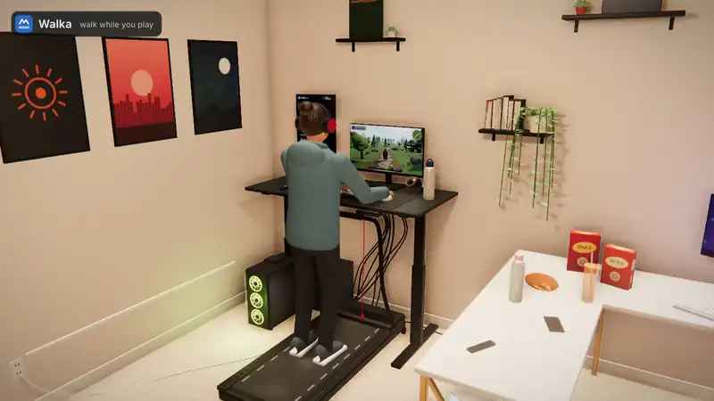

<h1 align="center">
   Walka
</h1>

  <b>Walk on your walking pad while you play World of Warcraft.</b> 
  Walka counts your steps, miles and calories, and draws your character's road on the map.

  

  

  

  <b>Walka only listens to your treadmill.</b> It cannot start, stop or change the speed of the belt: you do that at the treadmill itself. (Two kinds of older pads report only when asked: Walka asks them, with one fixed question - <a href="docs/SAFETY.md#one-exception-for-pads-that-only-report-when-asked">see Safety</a>.) 
  <b>Early version:</b> checked on one walking pad so far - a UREVO Strol 2E (URTM030) with Windows 11, in November 2026. Every other treadmill, and the Mac version, are still untried. Walking while you play is at your own risk - read the <a href="DISCLAIMER.md">disclaimer</a> before you download. 
  <b>Free.</b> Nothing to install: on Windows it is one file, <code>Walka.exe</code>, and you just open it - it has a window of its own, like any program. 
  <b>Mac:</b> the button is for an Apple chip (M1 or later) - for an older Mac with an Intel processor, <a href="https://github.com/AntonyPerez0/walka-addon/releases/latest/download/Walka-mac-intel.zip">download this one</a>.
  The Mac version is new and has not been tried with the game on a real Mac yet: see <a href="docs/INSTALL.md#on-a-mac">On a Mac</a>. 
  <b>Game addon:</b> the Walka addon for World of Warcraft. Walka can also put it in the game for you (step 3).

   
  

  
   <b>Walka in 3D</b> - <a href="docs/demo/walka-demo.mp4">watch the video</a> (31 s, no sound) · <a href="docs/demo/">the scene itself</a>, made with three.js: open <code>docs/demo/index.html</code> and look around

  <picture>
    <source media="(prefers-color-scheme: dark)" srcset="docs/images/dashboard-dark.png">
    
  </picture>

**Walka** is a free program for Windows and Mac, plus an addon for World of
Warcraft: Forever. It listens to your walking pad over Bluetooth, writes
down each walk - steps, distance, calories - and files it under the
character you are playing, once the game has saved (when you log out or
type `/reload`). Walka does not look at your screen: it reads only the
file the game saves for its addon. **You need:** a Windows 10 or 11 PC or a Mac
with Bluetooth, and a walking pad that shows its numbers to apps over
Bluetooth ([which treadmills work](docs/TREADMILLS.md)).

## Get started

1. **Download Walka** with a button above, and open it.
   * **Windows** may say *"Windows protected your PC"*: click **More info**,
     then **Run anyway**. A browser may say the file "isn't commonly
     downloaded": choose **Keep** (in Edge: **...** → **Keep** → **Show
     more** → **Keep anyway**). Walka is not signed by a company yet; this
     does not mean anything was found - see
     [Is the download safe?](docs/INSTALL.md#is-the-download-safe)
   * **Mac:** open the zip, then the **Walka** app in it. The first time,
     allow it under *System Settings → Privacy & Security → Open Anyway*.
     Details: [On a Mac](docs/INSTALL.md#on-a-mac).
2. **Follow the setup guide** that opens the first time. It connects the
   treadmill (switch it on, close its phone app, don't pair it in
   Bluetooth settings), installs the game addon, and asks your weight and
   height.
3. **Start the belt with the treadmill's own remote** and play. Walka
   records the walk by itself, with the game or without it. When you log
   out (or type `/reload`), the game saves which character you played, and
   Walka files the walk under it.

> [!NOTE]
> **Walka only listens to your treadmill.** It cannot start, stop or change
> the speed of the belt - nothing in it can. You set the speed at the
> treadmill, with its own remote and buttons. One exception: older
> WalkingPads and FitShow pads report their numbers only when asked, so
> Walka sends them one fixed "report your numbers" question once a second,
> and nothing else ([docs/SAFETY.md](docs/SAFETY.md#one-exception-for-pads-that-only-report-when-asked)).

> [!CAUTION]
> **Walking while you play is at your own risk.** Your eyes are on a game,
> not on your feet. Walka comes with no warranty, and it is not a safety
> device or a medical device. If you have a health condition, are pregnant
> or are in any doubt, ask a doctor first - and stop if you feel dizzy or
> unwell. Read the [disclaimer](DISCLAIMER.md) before your first walk.

## Safety

* **Walka cannot move the belt.** There is no command in it to send, and
  nothing the game or the dashboard does reaches the treadmill. The tests
  check that an emulated treadmill has been sent nothing - nothing but the
  one fixed status question, to the two kinds of pads that need it.
* **Stopping the belt is yours.** Walka is not a safety device: the
  treadmill's own stop button, remote and safety key are what stops it.
  Keep the remote within reach, start slow, stop the belt when you step
  off, and keep children and pets away from it.
* **Versions up to 0.6.1 could move the belt.** They have been withdrawn:
  replace one with the current download and delete the old `Walka.exe`.
* Found a way to make Walka send a treadmill anything at all? Report it in
  private: [SECURITY.md](SECURITY.md).

The whole of it: [docs/SAFETY.md](docs/SAFETY.md) and
[DISCLAIMER.md](DISCLAIMER.md).

## More

* [Installing Walka](docs/INSTALL.md) - step by step, on a Mac, Walka's window, [is the download safe?](docs/INSTALL.md#is-the-download-safe), [before your first walk](docs/INSTALL.md#before-your-first-walk)
* [Using Walka](docs/USING.md) - the dashboard, the floating window, your journey and a picture to share; [heart rate](docs/HEART-RATE.md)
* [Which treadmills work](docs/TREADMILLS.md) and [hardware notes](docs/HARDWARE.md)
* [How Walka works](docs/HOW-IT-WORKS.md) - what it reads, why it only listens, [is this allowed?](docs/HOW-IT-WORKS.md#is-this-allowed)
* [Your Walka account](docs/WALKA-ACCOUNT.md) on walka.dev - optional
* [Troubleshooting](docs/TROUBLESHOOTING.md) and [the in-game checklist](docs/IN-GAME-CHECKLIST.md)
* [Developing Walka](docs/DEVELOPMENT.md), [translating the dashboard](docs/TRANSLATING.md), [ANT+ design note](docs/ANT-PLUS-DESIGN.md)

Walka has a website too: <https://walka.dev/>
