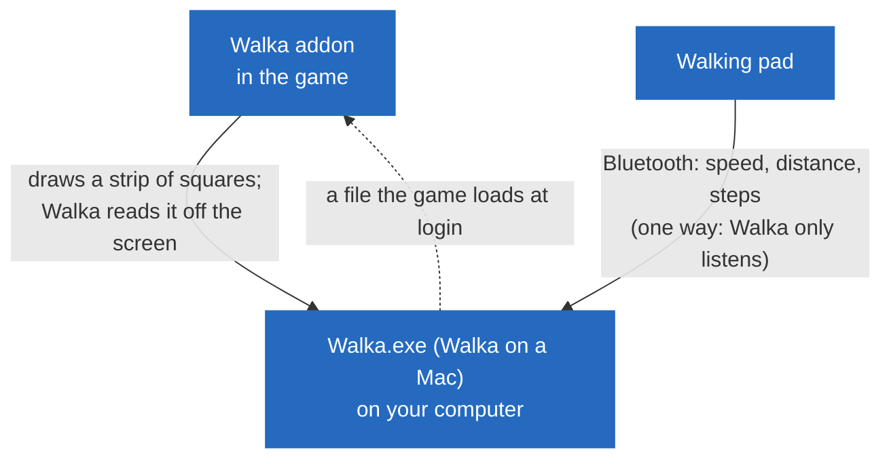

# How Walka works

[← Back to the README](../README.md) · [Disclaimer](../DISCLAIMER.md) · [Safety](SAFETY.md)

## What Walka is

Walka is a walking log for people who walk on an under-desk pad while they
play **World of Warcraft: Forever**. You walk at the speed you set on the
pad; Walka counts your time, steps, distance and calories - for this walk
and every one before it - shows them on its dashboard and, if you like, in
a small floating window on top of the game, and keeps them per
character.

It is two pieces:

* **the addon** (`Walka/`) - marks your walking sessions, knows which
  character they belong to, and sends the app your character's journey
  and road. It draws no windows in game: it is the game's end of the
  connection, and the app shows everything;
* **the companion** (`companion/`, the `Walka.exe` you download above, or
  `Walka` on a Mac) - a small app that reads the addon's signal off the
  screen, listens to the treadmill over Bluetooth, records your walks, and
  shows a live dashboard in a window of its own.

Neither of them moves the belt. Until version 0.6 the companion did: the
belt followed your character. That was taken out - a motorised belt under
someone who is looking at a game was not worth the risk of a program
getting it wrong - and those versions have been withdrawn. See
[Walka only listens](#walka-only-listens).

Built around the **UREVO Strol 2E (URTM030)**, and made to read any
treadmill that reports its data over standard Bluetooth FTMS - see
[which treadmills work](TREADMILLS.md#which-treadmills-work). The companion also works
without any game: a walk is recorded whenever the belt moves.

## How it works

An addon cannot use Bluetooth, files or the network, so it *draws* its state
as a thin strip of black and white squares in the top-left corner of the
game window, ten times a second. The companion takes a tiny screenshot of
that corner and decodes it. **Walka never sends input to the game** - no
key presses, no mouse input, no memory reading.

### What Walka looks at

* **The top-left corner of the game window** - a picture about 700 pixels
  wide and 12 high, some fifteen times a second. On Windows and on a Mac
  Walka asks the system where the game window is, and once it has found
  the game it looks nowhere else.
* **From when Walka is started until it first finds the game window** -
  that is, while the game is not running yet - it also looks at the
  top-left corner of each monitor and, every five seconds, takes one
  picture of the whole screen to search it for the strip. (So does a
  system that cannot say where a window is, all the time.) `Walka.exe
  beacon`, the command that checks whether the strip can be read, does the
  same once.
* **What happens to a picture:** it is searched for the strip, in the
  computer's memory, and then dropped. No picture is saved or sent
  anywhere, and of what is on it nothing is kept but the strip's ten bytes.
* **What the strip says:** whether a walking session is running or paused,
  how fast the character is going and how (on foot, mounted, swimming,
  flying, on a flight path), whether you are AFK, and the numbers of the
  [journey](USING.md#your-journey-and-a-picture-to-share). Not whether your
  character is fighting, dead or resting - the companion does not need to
  know, so the addon does not say.

An addon also cannot receive live data, so the addon itself only keeps an
estimate (counted from the pace you tell it: see
[Using it](USING.md#using-it)), for the journey numbers it sends; the companion's
*measured* numbers are written to a file the game loads at login or on
`/reload`. The dashboard - and the floating window on top of the game -
always show the measured numbers live.

Details: [docs/PROTOCOL.md](PROTOCOL.md).

## Walka only listens

Walka does not start, stop, pause or steer the belt. Not from the game,
not from the dashboard, not when something goes wrong.

* **You start the belt** with the treadmill's remote or buttons, and **you
  stop it** the same way - or with its safety key. Keep the remote where
  your hand finds it without looking.
* **The speed is the one you set** at the treadmill. Walka reads it; it
  cannot change it.
* **Closing Walka, or pressing *Disconnect*,** ends the recording and lets
  go of the treadmill. The belt goes on doing what it was doing.
* **When you step off, stop the belt.** Nothing else will.

What Walka does to a treadmill is this, and no more: it connects, reads
the speed range the treadmill says it has, and switches on the
notifications through which the treadmill reports its speed, distance and
status. The channel through which an app could control the belt (the
*Fitness Machine Control Point*) is never written to, and the code that
once did has been deleted - there is no setting that brings it back. How
that is checked: [docs/SAFETY.md](SAFETY.md).

**If you have a version up to 0.6.1:** it could move the belt. Those
downloads have been removed; replace it with the current one and delete
the old `Walka.exe`. Your walks and settings are kept (the settings that
were about steering the belt are simply no longer read), and the addon is
updated with *Install* on the dashboard.

## Safety

Short version - the long one is [docs/SAFETY.md](SAFETY.md):

* **Walka cannot move the belt.** It only listens to the treadmill. There
  is no command in it to send, no interface in it to send one through, and
  nothing the game or the dashboard does reaches the treadmill. The tests
  check that an emulated treadmill has been sent nothing after long runs of
  everything Walka can be made to do.
* **So the belt is entirely yours** - and so is stopping it. Walka is not a
  safety device and cannot stop a belt: the treadmill's own stop button,
  remote and safety key are what does.
* **You are walking while you look at a game.** Start slow, keep the remote
  within reach, stop the belt when you step off, and keep children and
  pets away from it.

Found a way to make Walka send a treadmill anything at all? Please report
it in private: [SECURITY.md](../SECURITY.md).

You use Walka at your own risk, with no warranty - see
[DISCLAIMER.md](../DISCLAIMER.md), which also says when to ask a doctor first.

## Is this allowed?

Honestly: **it is not approved by Blizzard, and you use it at your own
risk.**

What Walka does and does not do:

* The addon uses only the public addon API, is free and unobfuscated, and
  follows the addon policy.
* The companion never sends input to the game, never automates anything
  in the game and never reads the game's memory. Of the game's files it
  touches only Walka's own: the addon folder (it installs the addon and
  writes `CompanionData.lua` there) and the addon's saved file
  `WTF\Account\...\SavedVariables\Walka.lua`, which it only reads. It
  looks at the corner of the game window, the way a screenshot tool does
  ([exactly what](#what-walka-looks-at)), and what it reads there is your
  own character's movement state - not whether it is fighting, dead or
  resting, which the addon does not put on the strip. With sending to
  [your Walka account](WALKA-ACCOUNT.md#your-walka-account-on-walkadev) switched on, one
  thing read off the game goes with each walk: whether a walking session
  was running. Not your character, its name, its realm or its road.
* Walka is free, and stays free: no paid version, no advertising and no
  asking for money - in the game or outside it.
* When the game hides a value from addons (speed in combat), Walka does not
  relay it; it estimates instead.

Blizzard's enforcement statements target automation, input broadcasting,
client modification and tools that get around addon restrictions for an
advantage; Walka is none of those. But Blizzard's EULA is written broadly
(it prohibits unauthorised software that "reads" information from the
game), Blizzard does not pre-approve third-party tools, and no statement
says a passive screen reader like this is fine. Similar addon-plus-reader
projects exist publicly for this client; that is not the same as
permission.
