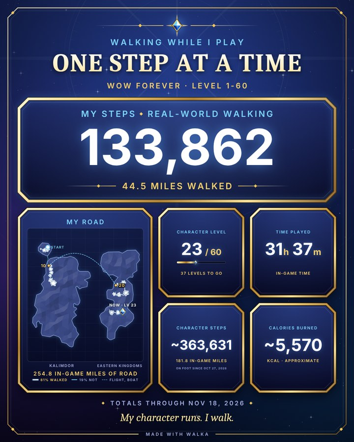

# Using Walka

[← Back to the README](../README.md) · [Disclaimer](../DISCLAIMER.md) · [Safety](SAFETY.md)

## What you get

- 👂 **Only listens.** Walka reads what your treadmill reports. It sends
  it no commands: the belt does what you tell it at the treadmill, and
  nothing else.
- 📊 **Counts every walk.** Time, distance, steps and calories - live on
  the dashboard, and in a small floating window on top of the game while
  you play. A walk is recorded
  whenever the belt moves, with a game or without.
- 🧙 **Your walks, per character.** Start a session in the game and the
  walk counts for the character you are playing.
- 🗺️ **Your road on the map.** The path your character has travelled,
  drawn on the map of the world on the dashboard's Share picture -
  brightest where you really walked.
- 🖼️ **A picture to share.** Your journey so far as a picture, made on
  your own computer. You choose what is on it and where it goes.
- 🔒 **Stays on your computer.** Nothing is uploaded unless you sign in to
  [your Walka account (on walka.dev)](WALKA-ACCOUNT.md#your-walka-account-on-walkadev) and
  switch sending on yourself. Walka never presses keys, moves the mouse or
  reads the game's memory - it looks at the top-left corner of the game
  window ([what it looks at, exactly](HOW-IT-WORKS.md#what-walka-looks-at)).

  
   A <b>Share</b> picture, made with the demo character

## The details

Everything below is the long version, for when you want it.

**The basics** ·
[What Walka is](HOW-IT-WORKS.md#what-walka-is) ·
[How it works](HOW-IT-WORKS.md#how-it-works) ·
[What you need](INSTALL.md#what-you-need) ·
[Which treadmills work](TREADMILLS.md#which-treadmills-work) ·
[Install, step by step](INSTALL.md#install-step-by-step) ·
[On a Mac](INSTALL.md#on-a-mac) ·
[Using it](#using-it)

**Walking** ·
[Walka only listens](HOW-IT-WORKS.md#walka-only-listens) ·
[Heart rate](#heart-rate-optional) ·
[Garmin Connect, Strava and others](#garmin-connect-strava-and-others) ·
[Your Walka account](WALKA-ACCOUNT.md#your-walka-account-on-walkadev) ·
[Your journey, and a picture to share](#your-journey-and-a-picture-to-share) ·
[The road map](#the-road-map) ·
[Other games, or no game](#other-games-or-no-game)

**Safety and help** ·
[Safety](HOW-IT-WORKS.md#safety) ·
[Disclaimer](../DISCLAIMER.md) ·
[Report a security problem](../SECURITY.md) ·
[Is the download safe?](INSTALL.md#is-the-download-safe) ·
[Is this allowed?](HOW-IT-WORKS.md#is-this-allowed) ·
[Before your first walk](INSTALL.md#before-your-first-walk) ·
[Troubleshooting](TROUBLESHOOTING.md#troubleshooting) ·
[Ideas for later](DEVELOPMENT.md#ideas-for-later) ·
[Development](DEVELOPMENT.md#development)

## Using it

Log in to the game with the addon: a walking session starts by itself for
the character you are playing (a chat line says so). Step onto the pad and
start the belt with the treadmill's remote, at whatever speed you like.
The addon draws nothing in game but the signal strip: the walk is on the
dashboard, and in the [floating window](#the-floating-window) if you
switch it on.

The session that starts by itself counts nothing on its own: Walka cannot
see the pad from inside the game. It only says whose walks are walked now;
what counts is what the treadmill measured while it ran. A login without a
walk is no walk.

The companion records the walk from what the treadmill reports. A walk is
whatever the belt does:

* it is counted while the belt moves, and not while it stands still;
* with a session running in the game it is filed under that session, and
  so under your character;
* with no session - another game, no game at all - it is recorded all the
  same, as a walk of its own (*No game session* in the dashboard's
  history).

**Pause** the session by clicking *Walka* in the game's AddOns menu (by
the minimap) - click again to carry on - and right-click it to stop it
until the next login. (`/walka pause`, `/walka resume` and `/walka stop` do
the same.) They pause and end the *session* - the addon's
count - and nothing else: stop the belt yourself, at the treadmill, when
you step off. Going AFK pauses the session automatically; it carries on
when your character next moves.

**Your pace** (`/walka pace 1.5`) is the speed you say the belt is set to,
for a session you start yourself with `/walka start` after switching the
automatic one off (`/walka auto off`). The addon counts its own estimate
of such a walk with it - for your
character's journey numbers, until the companion's measured numbers arrive
at the next login or `/reload`. It changes nothing at the treadmill, and
nothing on the dashboard, which always shows what the treadmill measured.

| Command | What it does |
|---|---|
| `/walka` | what the addon is for, and its commands |
| `/walka start` · `pause` · `resume` · `stop` | mark the walking session yourself (it starts by itself at login) |
| `/walka auto on` \| `off` | start the session by itself at login (on), or not |
| `/walka status` | what the addon is doing right now |
| `/walka pace 1.5` | the speed your treadmill is set to, for the addon's estimate |
| `/walka road on` \| `off` | record your character's road for the Share picture, or stop |
| `/walka weight 180lb` · `/walka height 5'11` | your body, if you do not run the companion |
| `/walka units mph` \| `kmh` | units of the addon's chat messages |
| `/walka beacon on` \| `off` \| `size 2-8` | the signal strip |

### The floating window

*Settings → Floating window → Show the floating window* opens a small
Walka panel that stays on top of every other window - the game's
included: the belt's speed, and this walk's steps, calories, distance and
time as the treadmill measures them (today's, with no walk), with your
day's steps against a goal along the bottom. It looks like the panel the
addon used to draw in game, but its numbers are measured, live, rather
than estimated.

* **Drag it** anywhere; it opens there next time. It first opens in the
  top-right corner of the screen - keep it away from the top-left corner
  of the game, where the strip is that Walka reads.
* **Its ×** closes it (the setting goes off with it).
* **Clicking it** does not take the keyboard from the game.
* It shows over the game when the game runs in *Windowed* or *Windowed
  (Fullscreen)* mode - as it has to for Walka to see the game at all.
* It needs Walka's own window: started with `--browser` or `--no-window`,
  or with its dashboard in the web browser, Walka has no floating window.

The dashboard is only reachable from the PC itself: it shows your walks,
weight and height - and the e-mail address of your Walka account, while
Walka is signed in to one - and has no password, so it is not offered to
other devices on your network.

### In combat

WoW: Forever hides your character's exact speed from addons during combat.
Walka does not work around that. While it is hidden the addon estimates:
moving or not, at your last known run speed. That only matters for the road
and the journey's "character steps" - your own walk is counted from the
treadmill, not from the character.

### Calories and steps

* **Calories** come from belt speed and your weight, using an equation
  validated at slow desk-walking speeds (the usual treadmill formula reads
  11-35% low there). Expect roughly ±10% for an individual. The dashboard
  also shows how much of it is *on top of* what sitting would have burned.
* **Steps** are the treadmill's own count if it reports one; otherwise they
  are estimated from belt speed and your height. People differ by 6-20% at
  slow speeds, so there is a *step calibration* setting: count your steps
  for a minute, divide by what Walka counted.
* A **wrist watch will not count these steps** - with your hands on the
  keyboard your arm does not swing. Walka's count is the record.

## Heart rate (optional)

Any Bluetooth heart-rate sensor works: a chest strap, an arm band, or a
watch that can broadcast. Dashboard → *Settings → Heart-rate sensor → Scan*.

**Garmin Instinct 2 / Instinct 2 Solar:** hold *MENU* → *Sensors &
Accessories* → *Wrist Heart Rate* → *Broadcast Heart Rate*, then press
*GPS* to start broadcasting (press it again to stop). Watch-to-Windows
Bluetooth is known to be hit-and-miss and broadcasting uses battery; a
cheap Bluetooth chest strap or arm band is the dependable option.

Heart rate is shown live and stored with each walk. It only drives the
calorie figure when you have entered age and sex *and* your heart rate is
in real exercise territory (above 60% of the maximum for your age, for a
minute) - at desk-walking heart rates the heart-rate formula would read up
to double.

## Garmin Connect, Strava and others

Each walk can be downloaded as a **TCX** file (dashboard → *History* → a
walk → *TCX*) and imported by hand: on connect.garmin.com, *Activities* →
*Import*. Imported walks show time, distance, calories and heart rate.
Garmin does not add their steps to your daily step total.

## Your journey, and a picture to share

Walka keeps a record for every character you play: the level it has
reached, its time played and how far it has travelled on foot - and next to
that the real walking *you* did while playing it. The dashboard's
**Share** page shows it, and turns it into a picture you can post.

1. Log in with the companion running. The character's numbers reach the
   companion within about ten seconds (over the same strip as everything
   else) and are remembered there, so the picture can also be made later,
   with the game closed.
2. Dashboard → *Share*. Pick the character if you have several, change the
   words, tick what should be on the picture, and choose a theme (Sapphire,
   Ember, Wildwood, Frost or Parchment) and a size: portrait 1080×1350,
   square 1080×1080, story 1080×1920 or wide 1200×675.
3. **Download PNG** - or **Copy image** and paste it straight into a post or
   a chat.

What is on it:

| On the picture | What it is |
|---|---|
| **My steps** | Your real-world steps, and under them the distance you walked. With *This character's walks* these are the walks you did while playing that character, as the addon counts them; with *All my walks* they are everything the companion has recorded, with any game or none. |
| **My road** | The road your character has travelled, as a line: see [The road on the picture](#the-road-on-the-picture). |
| **Character level** | The level, and the level cap of the game. |
| **Time played** | The game's own `/played` for this character. |
| **Character steps** | How far the character has gone on foot since Walka began tracking it, as steps, with the in-game distance under it. |
| **Calories** | The same estimate as everywhere else in Walka (see [Calories and steps](#calories-and-steps)), rounded. |
| *Totals through ...* | The day the numbers were last received from the game. |

A `~` in front of a number means "about":

* **Character steps are a convention.** The game does not count steps, so
  Walka says a character takes 2,000 steps to the in-game mile of 1,760
  yards - 0.88 yards a step. "On foot" is moving while not mounted, not on
  a flight path, not flying and not swimming; running back as a ghost and
  jumping count. In combat, where the game hides the exact speed, the
  addon's estimate is used. Distance is counted from the day the addon was
  installed, not from level 1.
* **Calories** are always an estimate.
* **Your own steps** carry a `~` only while part of them is still the
  addon's estimate, until the game has loaded what the treadmill measured
  (*Sync*, or the next login).

### The road on the picture

The road the addon records (see [The road map](#the-road-map)) is drawn on
the picture over a small map of the continent - not the game's map, but a
low-poly drawing of Walka's own: the shape of the land in facets, in the
picture's colours.

* The stretches you walked **on the treadmill** - a walking session was
  running in the game - are a bright line; what the character travelled
  without one is the same line in a quieter colour; flight paths are fine dashes. A key under the map shows a
  piece of each kind of line with what it means - and how much of the road
  you walked for real.
* *START* marks where the road begins, a gem marked *NOW* with the
  character's level where it is, and a small numbered stud every tenth
  level reached on the way. The words are put where they cover neither a
  mark nor the road.
* Kalimdor and the Eastern Kingdoms are shown whole, side by side on one
  sea and to one scale, with a dashed arc where you crossed from one to
  the other (the boat, the zeppelin).
* A character that has only been on one continent and has not gone far yet
  gets a **close-up**: the stretch of coast it has walked, with a small map
  of the whole continent in a corner that frames where that is. The
  close-up widens as the road grows; once it would show most of the
  continent anyway, all of it is shown.
* A long road - wound tight around every village, as roads are by level
  20 - is drawn with a finer line, so that it stays a road and not a blot.
* Under the map: the length of the road in in-game miles (flights not
  counted). This is the road the addon *recorded* - mounted stretches
  included, dungeons not - so it differs from the miles on foot in the
  *Character steps* tile.

The coasts are generalised - straight edges, small inlets filled in - but
the towns, harbours and quest areas lie on the land (all but a few tiny
islets, which are left off the map), so a line across the water means you
really were at sea.

**A land that is neither of the two continents** - the Skyborne begin on
Zephras Isle, an island in Skywall - is on the picture too, under the name
the game gives it. The companion has no map of such a land, so it draws
the ground the way a traveller charts it: **as far as your road has
reached** - a little to either side of where you went, and whatever you
walked around. It is a sketch that grows with your road, not the island's
true coast. On its own it fills the map; once your road is on the
continents as well, the isle has a smaller plate of its own beside the map
of the world (it is no part of that world, so it is not drawn to its
scale), with the passage from it - the airship - as a dashed arc. The
picture shows the three lands with the most road.

The road is far too much for the strip on the screen, so it takes the slow
way: **the game saves it when you log out or type `/reload`**, and the
companion reads it from the game's own file
(`WTF\Account\...\SavedVariables\Walka.lua` in the game's folder). So the
road on the picture is as of your last logout or `/reload` - the Share page
says when that was - while the numbers next to it are live. Type `/reload`
before you make the picture and both are current.

The companion has to know where the game is for this; it does when the
addon is installed (*Settings → Game addon*). The file is only ever read, never
changed. Untick *My road* and the picture is as it was without it.

Private by default:

* The picture is drawn on your computer, from numbers that are already
  on it. It is not uploaded, and nothing is posted for you.
* The road is read from a file on your PC and goes no further than the
  page that draws it. On the picture it is a line on a simplified map and
  the names of the continents (or of another land your road is on, such as
  Zephras Isle) - no zones, no place names, no coordinates.
* Your character's name, and the small line with your weight and average
  pace, are **off** until you tick them. The realm never leaves the game:
  the companion is only sent a number that tells your characters apart.
* The downloaded file is named after the date, never after the character.
* The design is Walka's own and is drawn by the page itself: no game
  artwork, logos or fonts are used. The continents on the map are Walka's
  own drawing too (see [THIRD-PARTY-NOTICES.md](../THIRD-PARTY-NOTICES.md) for
  how their outlines were made).

`py -m walka --demo` has a made-up character to try the page with; it is
never saved.

## The road map

From the moment the addon is installed it keeps the road your character
travels - install it before you start a character and the road begins at
level 1. It is drawn on the [Share picture](#the-road-on-the-picture), on
Walka's own map of the world: coloured by level, brightest where you walked
on the treadmill, with flight paths thin and pale. (Until version 0.9 the
addon also drew it on the game's world map. The addon has no windows any
more; the road is in the app.)

What is recorded: a point every twenty yards (fewer on flight paths, more
where the road bends), nothing while you stand still, nothing inside
dungeons, raids and battlegrounds (the game does not say where you are
there). It is saved per character with your other addon settings and never
leaves your PC (the companion reads it there, to draw it on the
[Share picture](#the-road-on-the-picture)). `/walka road off` stops the
recording (`on` starts it again); what is recorded so far is kept. A road
from level 1 to 60 comes to about a megabyte.

The way the road is recorded and drawn follows
[Road to Sixty](https://github.com/Jordanburch101/road-to-sixty) by Jordan
Burch (MIT licence, see [THIRD-PARTY-NOTICES.md](../THIRD-PARTY-NOTICES.md)) -
an addon made for exactly this, with a replay of the whole journey, a
journal of quests and kills, and much more. It runs fine next to Walka.

## Other games, or no game

Nothing to set up: the companion records a walk whenever the belt moves.
Start the belt with the treadmill's remote and play anything, or nothing.
Such a walk is in the dashboard's history as *No game session*, and in
your totals.

## Updates

Walka does not look for new versions unless you ask it to. *Settings →
Updates → Tell me when a new version of Walka is out* switches that on:
Walka then asks GitHub, once a day while it runs, which release is the
newest (the request names the program and its version, and nothing about
you), and shows a note with a link when there is a newer one. Walka never
downloads or installs anything by itself - the new version is downloaded
the same way as the first one, warnings and all (see
[Is the download safe?](INSTALL.md#is-the-download-safe)).
